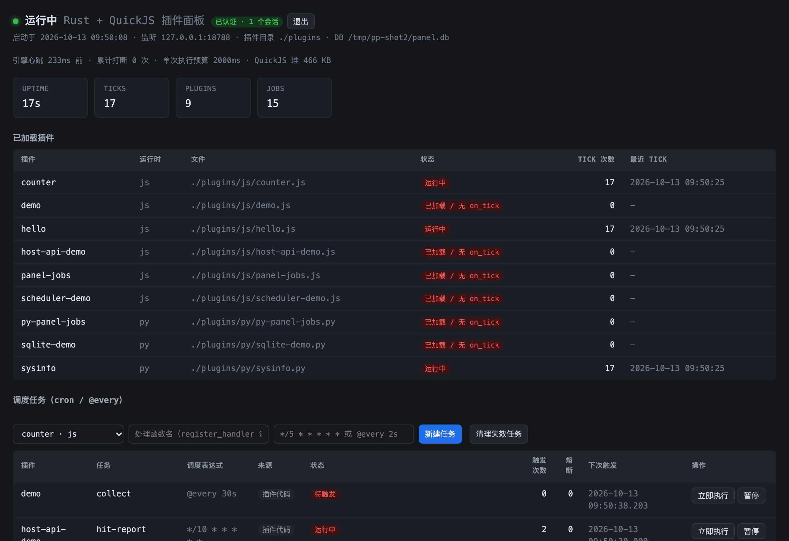
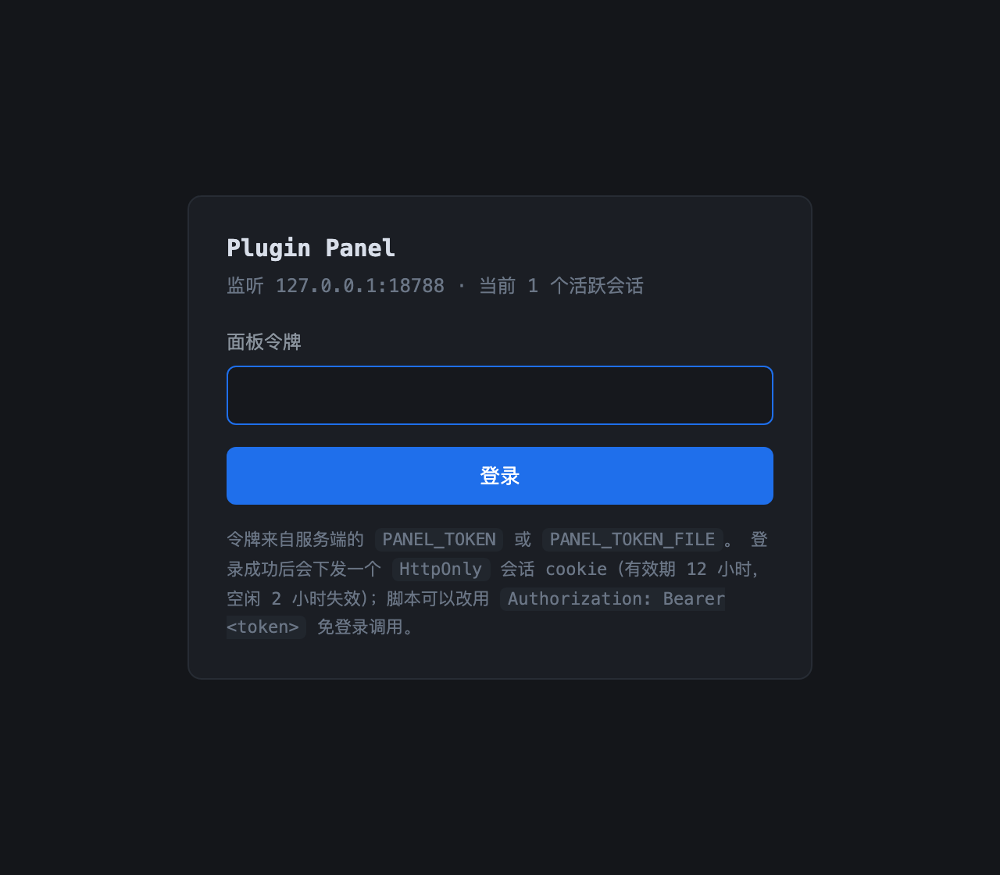
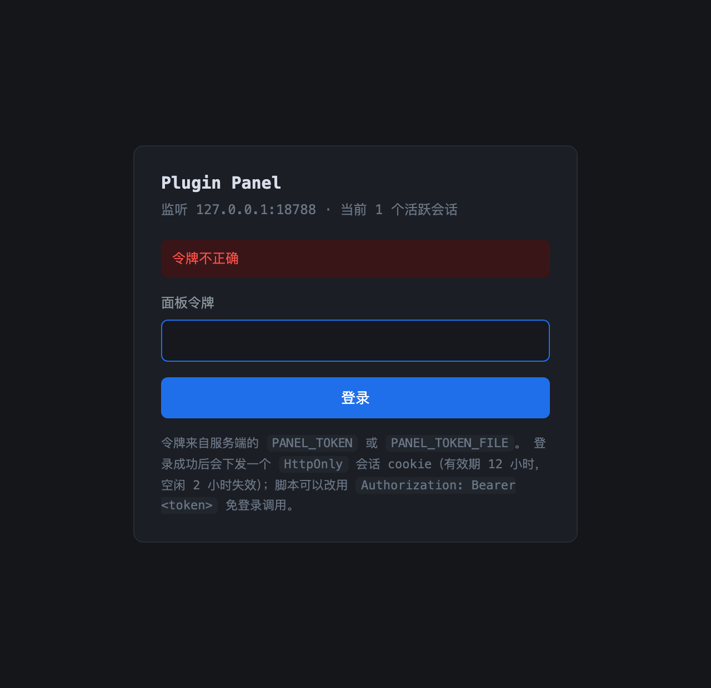
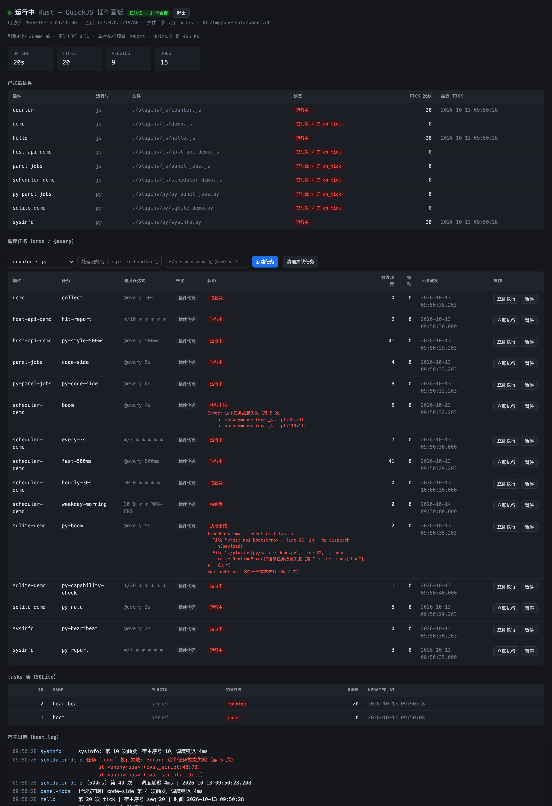

# plugin-panel —— Rust + QuickJS + PocketPy 动态插件任务面板

低配 ARM 盒子上的任务控制面板。最终目标：常驻内存极低 / JS+Python 动态插件 / 毫秒级 Cron / SQLite 持久化 / 单二进制。

**当前进度**

| 轮次 | 内容 | 状态 |
|---|---|---|
| 第一轮 | Axum + 嵌入 QuickJS + 插件加载 + `host.log` + SQLite + 每秒 `on_tick` | ✅ 已验证 |
| 第二轮 | 毫秒级 Cron 调度 + `jobs` 表持久化 + 面板任务视图 | ✅ 已验证 |
| 第三轮 | 执行预算（死循环防护）+ 任务熔断 + 引擎健康上报 + SIGTERM 优雅退出 | ✅ 已验证 |
| 第四轮 | 内存优化（tokio worker 收敛）+ 跨平台 CI + 静态 musl 产物 | ✅ 本机已验证，ARM 待 CI |
| 第五轮 | 部署与分发（install.sh 一键安装 + 打 tag 自动发 Release）+ SQLite 内存参数实测复核 | ✅ 脚本已测（15 项用例），Release 流水线待打 tag 验证 |
| 第六轮 | **双运行时：嵌入 PocketPy 跑 Python 插件 + 抽象宿主 API（`host-api`/`host_api`）+ JS 插件 HTTP 路由 + mtime 热更新** | ✅ 本机已验证（含双运行时冒烟、静态 musl 产物 4.4 MB） |
| 第七轮 | Node.js / CPython 适配器（同一份插件跨 4 个运行时） | ✅ 适配器自带用例（Node 20 / CPython 51 项），交叉验证见 §10.5 |
| 第八轮 | **面板从只读变可操作**：手动触发 / 暂停 / 恢复，暂停状态跨重启保留 + 写接口防 CSRF | ✅ 已验证（冒烟 24 项含 6 项面板写操作） |
| 第九轮 | **`jobs` 表成为任务定义的权威来源**：`source` 区分「插件声明 / 面板创建」，面板可新建 / 删除任务 + `register_handler` 把处理函数与调度拆开 + 修掉第八轮的两个真 bug | ✅ 已验证（单测 47 项、冒烟 38 项、适配器 Node 24 / CPython 61 项） |
| 第十轮 | **面板鉴权**：`PANEL_TOKEN` 令牌 + 内存会话 cookie（HttpOnly/SameSite=Strict）+ 常量时间比较 + 登录退避 + 审计日志；非回环且无令牌时**拒绝启动** | ✅ 已验证（单测 73 项、冒烟 64 项、前端 32 项） |
| 后续 | 完整前端 / 插件市场 / 多实例 / 面板任务编辑 | 未开始 |

**界面**（`node scripts/screenshot.mjs` 生成，见 §5 第 ㉒ 条）：



页头右边那个绿色徽标是第十轮的鉴权状态；任务表的「来源」列是第九轮的
`jobs.source`（`插件代码` / `面板`）。没开鉴权时徽标变成橙色的
[「无鉴权（仅本机）」](docs/screenshots/panel-noauth.png) —— 一个不吭声就「没鉴权」
的面板比一个明确标注的更危险。

---

## 1. 架构

```
            tokio 多线程 runtime                      专用 OS 线程 (std::thread)
  ┌────────────────────────────────┐   ┌──────────────────────────────────────────────┐
  │  Axum (axum::serve)            │   │  QuickJS Runtime (独占, 非 Send)              │
  │    公开: GET  /login 登录页      │   │    ├─ Context  hello.js                       │
  │          POST /api/login        │   │    ├─ Context  host-api-demo.js               │
  │    其余全过 require_auth 中间件  │   │    └─ Context  counter.js                     │
  │    GET  /          服务端渲染   │   │                                              │
  │    GET  /api/state JSON 快照    │   │                                              │
  │    fallback: 插件注册的 HTTP 路由│   │                                              │
  │         │                      │   │                                              │
  │         └── EngineCmd::HttpRequest ──>│  PocketPy 2.2.0（惰性初始化，非 Send）        │
  │                                │   │    ├─ VM 1     sysinfo.py                    │
  │  tokio::time::interval(1s) ───Tick──>│    └─ VM 2     sqlite-demo.py                 │
  │                                │   │                                              │
  │  rusqlite (Arc<Mutex<Conn>>)   │   │  ┌── Scheduler (deadline 驱动) ──┐            │
  │    tasks 表  —— 运行记录        │   │  │  next_fire = 最近到期时刻      │            │
  │    jobs  表  —— 调度任务        │<──┼──┤  recv_timeout(next_fire - now) │            │
  └────────────────────────────────┘   │  │  到期 → __dispatch_task(name)  │            │
                                       │  └────────────────────────────────┘            │
                                       │  host_api.* ──> HostState::do_* ──> 日志/SQLite │
                                       │  插件文件 mtime 变了 ──> 重建解释器 + 重登记任务 │
                                       └──────────────────────────────────────────────┘
```

**两个运行时共用一套宿主 API 与一个调度器**（`src/hostapi.rs` 是唯一实现）：

| 链路 | JS 插件 | Python 插件 |
|---|---|---|
| 注册任务 | `host.cron` / `register_cron` → 闭包捕获的 `pending` | `host_api.register_cron` → 原生函数 → `HostState.vms[vm].pending` |
| 触发任务 | `__dispatch_task(name, payloadJson)` | `__pp_dispatch(name, payloadJson)` |
| 每秒心跳 | 全局 `on_tick(payload)` | `__main__` 里的 `on_tick(payload)` |
| 执行预算 | QuickJS interrupt handler（墙钟） | pocketpy watchdog（**CPU 时间**） |
| 隔离粒度 | 一个插件一个 `Context` | 一个插件一个 `VM`（`py_switchvm`，最多 15 个） |
| HTTP 路由 | ✅ 挂在 Axum 同一端口 | ❌ 抛 `NotImplementedError`（能力边界写死） |

三条链路：

- **Rust → 插件**：`tokio::time::interval` 每秒投 Tick（`on_tick`）；调度器到点投 `__dispatch_task` / `__pp_dispatch`
- **插件 → Rust**：`log / register_cron / sqlite_query / http_fetch`，一律 String 进 String 出（JSON 语义）
- **Rust → SQLite**：`tasks` 表心跳、`jobs` 表任务状态与 `last_error`

鉴权在 HTTP 层，**对插件完全不可见**：中间件挂在路由之外，
插件注册的 `fallback` 路由同样受保护（用 `layer` 而不是 `route_layer`，
后者不覆盖 fallback —— 那会让插件路由成为唯一不需要认证的入口）。见 §13。

跨运行时的完整 API 规范见 [`docs/host-api.md`](docs/host-api.md)。

## 2. 目录结构

```
rust-plugin-panel/
├── Cargo.toml
├── build.rs           编译 vendored 的 pocketpy（amalgamated 单文件 C）+ 打开 watchdog
├── install.sh          一键安装：架构检测 → 下载 → SHA256 校验 → 装进 PATH
├── vendor/pocketpy/    pocketpy v2.2.0（pocketpy.c / pocketpy.h / pp_shim.c / VERSION）
├── src/
│   ├── main.rs        启动顺序：SQLite → 宿主状态 → 引擎线程 → tick 循环 → Axum
│   ├── engine.rs      ★ 引擎线程：QuickJS + PocketPy + 调度器 + 热更新 + 路由分发
│   ├── hostapi.rs     ★ 宿主 API 的**唯一实现**（两个嵌入式宿主共用，HostState::do_*）
│   ├── jshost.rs      ★ JS 侧适配：内置 `host-api` 模块源码 + `__host_*` 原生函数
│   ├── pyhost.rs      ★ Python 侧适配：`host_api` 模块 + 原生函数 + 引导脚本
│   ├── python.rs      ★ PocketPy FFI 薄封装（PyVm / 参数读取 / 预算 / traceback）
│   ├── cron.rs        Cron 表达式解析 + next_after（13 个单测）
│   ├── scheduler.rs   调度器：deadline 驱动、熔断退避、按插件/按任务摘除（14 个单测）
│   ├── auth.rs        ★ 第十轮：令牌 + 内存会话 + 登录退避（不依赖 axum，17 个单测）
│   ├── db.rs          SQLite：tasks 表 + jobs 表（含第九轮的 source 列，11 个单测）
│   └── web.rs         Axum 路由 + 服务端渲染面板 + 插件路由 fallback
├── plugins/
│   ├── js/
│   │   ├── hello.js            on_tick + host.log 示例
│   │   ├── counter.js          验证「每个插件独立 Context」
│   │   ├── scheduler-demo.js   cron / 毫秒级任务示例
│   │   ├── host-api-demo.js    ★ 跨运行时写法：import 'host-api' + 注册 HTTP 路由
│   │   └── panel-jobs.js       ★ 第九轮：register_handler 登记处理函数，调度交给面板
│   └── py/
│       ├── sysinfo.py          ★ 最小 Python 插件（every + cron + on_tick）
│       ├── sqlite-demo.py      ★ SQLite 往返 + 错误隔离 + 能力边界（register_route 报错）
│       └── py-panel-jobs.py    ★ 第九轮：同一件事的 Python 版
├── adapters/                  让同一份插件脚本跑在别的运行时里
│   ├── node/                  npm 包 `@plugin-panel/host-api`（node:sqlite + 内置 http server + 同步 http_fetch）
│   └── python/                模块 `host_api`（stdlib sqlite3/urllib + 运行器）
├── docs/host-api.md    跨运行时 API 规范 v1（四个宿主的能力矩阵与语义约定）
├── docs/screenshots/   文档里的界面截图（由 scripts/screenshot.mjs 生成）
├── scripts/
│   ├── smoke.py            端到端冒烟：双运行时、插件路由、Python 任务真的触发
│   ├── test-panel-frontend.mjs  面板前端逻辑回归（DOM 桩跑 web.rs 里的 <script>）
│   ├── screenshot.mjs      用 CDP 驱动 headless Chrome/Edge 截图（零 npm 依赖）
│   └── test-install.sh     install.sh 的 15 项用例（shim 假造 Release）
├── .github/workflows/
│   ├── ci.yml              三平台单测 + 冒烟（含真 ARM64 硬件）
│   └── release.yml         打 tag 发多架构静态产物 + 发布后自测安装
└── examples/
    ├── probe.rs            分层探针：逐项验证 tokio/sqlite/rquickjs 可用
    ├── broken-plugins/     容错测试：坏插件不影响好插件
    ├── hostile-plugins/    执行预算 / 熔断测试：JS 死循环插件
    ├── hostile-py-plugins/ 同一件事的 Python 版（验证 pocketpy watchdog）
    └── recovery-plugins/   熔断恢复测试：先失败几次再正常
```

## 3. 运行

```bash
cd rust-plugin-panel
cargo run                    # 首次会编译 SQLite bundled + QuickJS-ng + PocketPy
open http://127.0.0.1:8787/  # 面板
```

| 环境变量 | 默认值 | 说明 |
|---|---|---|
| `BIND_ADDR` | `127.0.0.1:8787` | 监听地址 |
| `PLUGINS_DIR` | `plugins` | 插件目录（递归两层，`.js` / `.py` 都收） |
| `DB_PATH` | `data/panel.db` | SQLite 文件 |
| `EXEC_BUDGET_MS` | `2000` | 单次 JS **或 Python** 调用的执行预算；调大它可复现 `degraded` 场景 |
| `JOB_TRIP_THRESHOLD` | `5` | 连续失败多少次熔断该任务 |
| `JOB_COOLDOWN_MS` | `30000` | 首次熔断的冷却时长 |
| `JOB_MAX_COOLDOWN_MS` | `600000` | 指数退避的冷却上限 |
| `PANEL_TOKEN` | 空 | **面板令牌**。设了就开鉴权（见 §13）。空字符串等于没设 |
| `PANEL_TOKEN_FILE` | 空 | 从文件读令牌（systemd 用；内容会 trim，适合放 600 权限的文件）。两个都设时 `PANEL_TOKEN` 优先 |
| `PANEL_COOKIE_SECURE` | 空 | `1`/`true`/`yes`/`on` → 会话 cookie 加 `Secure`。**走反代加了 TLS 时才开**（纯 HTTP 下开了 cookie 存不下来） |

**后台常驻**（脱离终端，不随 shell 退出）：

```bash
setsid ./target/release/plugin-panel > /tmp/panel.log 2>&1 < /dev/null &
```

## 4. 插件 API

完整规范（四个运行时的能力矩阵、语义约定、错误约定）见 **[`docs/host-api.md`](docs/host-api.md)**。

### JS 插件

```javascript
// 老写法（第一～五轮，继续可用）
host.log(...) / host.warn(...) / host.error(...)   // console.* 同样转发
host.cron(name, expr, handler)      // expr: 5 段或 6 段 cron
host.every(name, interval, handler) // interval: '500ms' / '2s' / '1m' / '1h'

// 跨运行时写法（第六轮）—— 同一份文件在 Node 里也能跑
import { log, register_cron, every, sqlite_query, sqlite_exec, http_fetch, register_route } from 'host-api';

// 第九轮：只登记处理函数，不声明调度 —— 任务由面板创建
import { register_handler } from 'host-api';
register_handler('echo', (payload) => { log(`第 ${payload.runs} 次`); });

// 每秒一次的心跳回调
function on_tick(payload) { /* payload = { seq, ts } */ }

// handler 收到的 payload
// { name, plugin, expr, runs, scheduledAt, firedAt, lateMs }
//   runs    = 生命周期内第几次触发（跨重启接着数，见 §12.3）
//   lateMs  = 实际触发比原定晚了多少毫秒 —— 用来观察调度精度
```

带顶层 `import` / `export` 的文件按 **ES 模块**加载（引擎线程装了自定义 Resolver/Loader，
把 `host-api` 解析成内置模块），否则按普通脚本 eval。两种写法可以混用。

### Python 插件

```python
from host_api import log, register_cron, every, register_handler, sqlite_query, sqlite_exec, http_fetch

log("插件加载中")

def heartbeat(payload):                 # payload 字段与 JS 完全一致
    sqlite_exec("INSERT INTO hits (at) VALUES (?1)", [payload["firedAt"]])

every("py-heartbeat", "2s", heartbeat)

# 第九轮：只登记处理函数，不声明调度 —— 任务由面板创建
def echo(payload):
    log("第 " + str(payload["runs"]) + " 次")

register_handler("echo", echo)

def on_tick(payload):                   # 可选，语义与 JS 的 on_tick 相同
    pass
```

Python 插件跑在嵌入的 **PocketPy 2.2.0** 里（不是 CPython），每个插件一个独立 VM。
语法是 CPython 3.9 级别的子集，缺口见 `docs/host-api.md` §4（生成器表达式、`finally`、
`nonlocal`、`async` 都没有）。

任务名在**同一插件内**必须唯一，重名会让插件加载直接失败（不静默覆盖）。
`register_cron` 与 `register_handler` **共用同一个名字空间**，两个方向都会查重。

### 处理函数 vs 调度：`register_handler`（第九轮）

| 注册方式 | 任务定义来源 | 面板上 |
|---|---|---|
| `register_cron` / `every` | `jobs.source = 'plugin'` | 可暂停、**不可删除**（删了下次 `sync_jobs` 也会装回来） |
| `register_handler` + 面板建任务 | `jobs.source = 'panel'` | 可暂停、可删除 |

拆开的意义：**面板只能提供调度，不能提供代码**。插件先把「可以被调度调用的处理函数」登记出来，
面板再从里面挑一个挂上表达式 —— 「插件的能力只能来自插件代码」这条线没有破。
同一个 handler 还能被面板上的多条任务复用（挂不同表达式）。

Node / CPython 适配器里没有面板，等价做法是运行器的 `--job`：

```bash
cd adapters/node && node bin/run.mjs ../../plugins/js/panel-jobs.js --job echo=@every 2s --duration 5
cd adapters/python && python3 -m host_api ../../plugins/py/py-panel-jobs.py --job py-echo=@every 2s --run-for 5
```

### 热更新

插件文件的 mtime 变了 → 引擎重建它的解释器实例（JS 换新 Context、Python 复用同一 VM 索引并
`py_resetvm`）、摘掉它的旧任务、重新登记新任务。改完存盘即可，不用重启进程：

```
[20:40:26] [sysinfo] [info] sysinfo-v2: 已加载（pocketpy 插件，from host_api import ...）
[20:40:26] [sysinfo] [info] 插件已热更新（摘掉 2 个旧任务，登记 2 个新任务）
```

顺序上「先摘旧的、再装新的」：即使新版本加载失败，面板上也不会留下幽灵任务。

热更新之后还有三步收尾（第九轮补的，每一步都对应一个实测出来的坑，见 §12.4）：

1. **装回面板任务** —— 它们不在插件代码里，`install_tasks` 装不到
2. **灌回累计计数** —— 否则「触发次数」归零、熔断退避从头开始
3. **恢复暂停状态** —— 否则改一次插件文件，用户暂停的任务就自己活过来了

### 面板上的写操作（第八轮 / 第九轮）

面板原来只能看。现在任务表有三个按钮：**立即执行** / **暂停·恢复** / **删除**（删除只给面板任务），
下面还有一个新建任务的表单。

| 接口 | 作用 |
|---|---|
| `POST /api/jobs` | 新建任务定义（body: `{"plugin","name","expr"}`） |
| `POST /api/jobs/{plugin}/{name}/edit` | 改调度表达式（body: `{"expr"}`；保留 `runs` 与暂停状态，见 §15.1） |
| `POST /api/jobs/{plugin}/{name}/delete` | 删除任务定义（只允许 `source = 'panel'`） |
| `POST /api/jobs/cleanup` | 清理失效的面板任务（body: `{"dry_run":true}`；见 §15.3） |
| `POST /api/tasks/{plugin}/{name}/run` | 立即执行一次 |
| `POST /api/tasks/{plugin}/{name}/pause` | 暂停（不再被调度） |
| `POST /api/tasks/{plugin}/{name}/resume` | 恢复（从当前时刻重新对齐，**不补跑**） |
| `POST /api/test/js` | 测试运行一段 JS（body: `{"code","input"}`；见 §16.5） |
| `POST /api/test/py` | 测试运行一段 Python（同上） |

`jobs` = 任务**定义**（新增 / 编辑 / 删除 / 清理失效），`tasks` = 任务**操作**（执行 / 暂停 / 恢复），
`test` = **一次性解释器**（不碰已加载插件的状态，跑完即弃）。

### 面板页面

| 路径 | 内容 |
|---|---|
| `/` | 主面板（`web/` 下的多文件前端，编译期内嵌） |
| `/classic` | 旧版单文件页面（保留一轮，见 §16.2） |
| `/plugins/{name}/` | **插件作者**提供的配置页（只管理这个插件自己的配置，见 §16.3） |

> 第八轮的这三个按钮**在页面上点了没反应** —— 后端接口和按钮都写好了，
> 但前端的 click 委托漏了（`web.rs` 里那句「见下面的 click 监听」下面根本没有监听）。
> 第九轮补上，并顺手把「请求进行中禁用按钮」也做了。见 §12.4 的 bug ①。

三条语义，都是刻意设计的：

1. **手动触发对插件完全透明**。`run_one` 是同一条代码路径（`engine.rs`），
   payload 字段与调度触发一模一样 —— 插件不需要区分「我是被定时叫醒的还是被人点的」。
   区别只在宿主侧：手动触发**不推进 `next_fire`**（不打乱节奏），
   也**不动熔断状态**（失败不计入连续失败，否则调试时点几下就把任务弄熔断了；
   成功也不解除熔断，否则等于开了个「绕过熔断器猛点」的口子）。
2. **恢复不补跑**。暂停期间错过的触发一律丢掉，从当前时刻重新对齐。
   否则一个被暂停一天的 `@every 500ms` 任务在恢复瞬间要面对 17 万次欠账。
   实测：暂停 3 秒后恢复，2.5 秒内触发 5 次（正好是 `@every 500ms` 的节奏）。
3. **暂停状态跨重启保留**。写进 `jobs.paused`，引擎启动时读回来。
   这是「`jobs` 表成为权威来源」的第一步 —— 任务定义仍由插件代码声明（代码即配置），
   但**用户对任务的操作**必须活过重启，否则重启一次，你暂停掉的那个每 500ms 烧 CPU
   的任务就自己活过来了。实测重启后日志里出现「任务 `py-heartbeat` 按上次的暂停状态继续暂停」。

4. **删除只对面板任务开放**（第九轮）。插件代码声明的任务删了也会在下一次
   `sync_jobs`（重启 / 热更新）里原样回来，给个能点的删除按钮等于骗人；
   要让它停下来请用「暂停」—— 那才是跨重启保留的用户意图。
   实测：`POST /api/jobs/panel-jobs/code-side/delete` → `400`，
   错误文本是「任务 `code-side` 由插件 `panel-jobs` 的代码声明（source = plugin），
   不能在面板上删除；想让它停下来请用「暂停」」。

写接口要求带请求头 **`x-panel: 1`**，否则 403。这不是鉴权，是防 CSRF：
浏览器跨站发起的「简单请求」不允许带自定义头，想带就会触发 CORS 预检，
而本服务不返回任何 CORS 响应头，预检必然失败 —— 恶意网页没法借用户的浏览器点这些按钮。

> 第十轮起**上面这些接口默认还要求认证**（`PANEL_TOKEN`，见 §13），
> 所以下面的 curl 在开了鉴权时要补一个 `-H "Authorization: Bearer $TOKEN"`。
> `x-panel: 1` 保留下来做纵深防御 —— 它也是「没开鉴权」那种部署下唯一的 CSRF 防线。

```bash
B=http://127.0.0.1:8787
curl -s -X POST -H 'x-panel: 1' $B/api/tasks/host-api-demo/py-style-500ms/run      # {"ok":true}
curl -s -X POST -H 'x-panel: 1' $B/api/tasks/scheduler-demo/boom/run               # {"ok":false,"error":"Error: ..."}
curl -s -X POST -H 'x-panel: 1' $B/api/tasks/sysinfo/py-heartbeat/pause            # {"ok":true,"paused":true}
curl -s -X POST -H 'x-panel: 1' $B/api/tasks/sysinfo/py-heartbeat/resume           # {"ok":true,"paused":false}
curl -s -o /dev/null -w '%{http_code}\n' -X POST $B/api/tasks/sysinfo/py-heartbeat/run   # 403（缺头）

# 第九轮：新建 / 删除面板任务
curl -s -X POST -H 'x-panel: 1' -H 'content-type: application/json' \
  -d '{"plugin":"panel-jobs","name":"echo","expr":"@every 1s"}' $B/api/jobs         # {"ok":true}
curl -s -X POST -H 'x-panel: 1' $B/api/jobs/panel-jobs/echo/delete                 # {"ok":true}
curl -s -X POST -H 'x-panel: 1' $B/api/jobs/panel-jobs/code-side/delete            # 400（插件声明的任务）
curl -s -X POST -H 'x-panel: 1' -H 'content-type: application/json' \
  -d '{"plugin":"panel-jobs","name":"nope","expr":"@every 1s"}' $B/api/jobs        # 400（没有这个处理函数）
```

返回码约定：任务跑了但失败是 **`200` + `{"ok":false,"error":"..."}`**（请求本身成功了，
错误文本原样带回面板）；`400` 校验没过（新建任务时）、`403` 缺护栏头、`404` 任务不存在、
`503` 引擎不可用、`504` 超时。

新建任务的全部校验都在**引擎线程**里串行做（插件存在 → 名字没被占用 → 表达式能解析 →
处理函数真的存在），失败原因原样带回面板。最后一条会真的调一次插件的解释器
（`__has_task` / `__pp_has_task`），所以名字写错在**创建的那一刻**就报出来，
而不是等它一路失败到熔断。

### Cron 语法

| 形式 | 例子 | 含义 |
|---|---|---|
| 6 段 | `*/5 * * * * *` | 每 5 秒（秒 分 时 日 月 周） |
| 5 段 | `30 9 * * MON-FRI` | 工作日 09:30（秒固定为 0） |
| 范围 | `0 0 9-11,18 * * *` | 每天 9/10/11/18 点整 |
| 步长 | `*/15 * * * *` | 每 15 分钟 |
| 间隔 | `@every 500ms` | 毫秒级固定间隔 |

星期 `0` 和 `7` 都是周日；月份/星期支持 `JAN`..`DEC` / `SUN`..`SAT`。

**日 / 周的 OR 语义**（经典 Vixie cron，很多简易实现会写错）：
两个字段都受限时满足**任一**即可；只有一个受限时以它为准。

## 5. 怎么验证

```bash
# ① 单元测试（cron 解析 + 调度推进 + jobs 表来源语义，含毫秒级防回归）
cargo test

# ①b 面板前端逻辑回归：把 web.rs 里的 <script> 抠出来配 DOM/fetch 桩跑，不需要浏览器
node scripts/test-panel-frontend.mjs
node scripts/test-panel-frontend.mjs /tmp/old-web.rs   # 传路径做回归验证：旧版本必须报红

# ①c 前端资源静态检查（web/ 与 plugins/demo/）：ES Module 语法、没有内联 CSS/JS、
#     CSS 里没有硬编码色值、plugins/js/*.js 没用嵌入式 QuickJS 不存在的全局
node scripts/test-web-assets.mjs

# ② 看面板
open http://127.0.0.1:8787/

# ③ 调度任务落库情况（第九轮起多了 source 列：plugin / panel）
sqlite3 -header -column data/panel.db \
  "SELECT plugin,name,schedule,source,status,runs,last_run,next_run,last_error FROM jobs;"

# ④ 依赖分层探针（怀疑环境问题而不是代码问题时先跑这个）
cargo run --example probe

# ⑤ 容错验证（坏插件不影响好插件）
PLUGINS_DIR=examples/broken-plugins BIND_ADDR=127.0.0.1:8791 cargo run

# ⑥ 执行预算验证：死循环任务被打断，同目录对照组仍在跑
PLUGINS_DIR=examples/hostile-plugins BIND_ADDR=127.0.0.1:8792 cargo run

# ⑦ 健康上报验证：把预算调大，引擎会真的卡住，面板应诚实报 degraded
EXEC_BUDGET_MS=10000 PLUGINS_DIR=examples/hostile-plugins \
  BIND_ADDR=127.0.0.1:8792 cargo run

# ⑧ 熔断验证：连续失败 3 次即熔断，CPU 应降下来（默认阈值 5 / 冷却 30s）
EXEC_BUDGET_MS=500 JOB_TRIP_THRESHOLD=3 JOB_COOLDOWN_MS=5000 \
  PLUGINS_DIR=examples/hostile-plugins BIND_ADDR=127.0.0.1:8792 cargo run

# ⑨ 安装脚本用例（六条分支，macOS 上也能跑）
bash scripts/test-install.sh

# ⑩ 端到端冒烟：双运行时都加载 + 插件路由 + Python 任务真的触发 + 优雅退出
cargo build --release && python3 scripts/smoke.py ./target/release/plugin-panel

# ⑪ Python 侧的执行预算（pocketpy watchdog）：死循环被打断 + 对照组照跑
PLUGINS_DIR=examples/hostile-py-plugins EXEC_BUDGET_MS=500 \
  BIND_ADDR=127.0.0.1:8793 cargo run

# ⑫ 插件注册的 HTTP 路由（挂在同一个 Axum 端口上）
curl -i http://127.0.0.1:8787/hits            # JS 插件注册的 GET
curl -i -X POST "http://127.0.0.1:8787/hits?tag=x" -d 'body'   # POST + 查询串 + 请求体
curl -o /dev/null -w '%{http_code}\n' http://127.0.0.1:8787/nope   # 404

# ⑬ 热更新：改完插件存盘，看日志出现「插件已热更新」
$EDITOR plugins/py/sysinfo.py

# ⑭ 面板写操作（手动触发 / 暂停 / 恢复）
curl -s -X POST -H 'x-panel: 1' http://127.0.0.1:8787/api/tasks/scheduler-demo/boom/run
curl -s -X POST -H 'x-panel: 1' http://127.0.0.1:8787/api/tasks/sysinfo/py-heartbeat/pause
curl -s -X POST -H 'x-panel: 1' http://127.0.0.1:8787/api/tasks/sysinfo/py-heartbeat/resume

# ⑯ 面板新建 / 删除任务（第九轮）：面板只提供调度，代码在插件里
curl -s -X POST -H 'x-panel: 1' -H 'content-type: application/json' \
  -d '{"plugin":"panel-jobs","name":"echo","expr":"@every 1s"}' http://127.0.0.1:8787/api/jobs
sleep 3 && sqlite3 -header -column data/panel.db \
  "SELECT plugin,name,source,status,runs FROM jobs WHERE source='panel';"   # runs 应该在涨
curl -s -X POST -H 'x-panel: 1' http://127.0.0.1:8787/api/jobs/panel-jobs/echo/delete

# ⑰ 面板任务跨重启存活（面板建的 + 面板暂停的，重启后都该原样回来）
#     重启后看日志应有「任务 `echo` 按上次的暂停状态继续暂停」，且 runs 从历史值接着数

# ⑱ 面板任务在插件热更新后存活（这条曾经是坏的，见 §12.4 bug ②）
touch plugins/js/panel-jobs.js     # 触发 mtime 热更新
#     热更新后面板任务应仍在、暂停状态应仍在、runs 历史应仍在

# ⑮ 同一份插件跑在别的运行时里（跨运行时验证）
cd adapters/node   && node test/run-tests.mjs && node bin/run.mjs ../../plugins/js/host-api-demo.js --once
cd adapters/python && python3 -m unittest discover -s tests && python3 -m host_api ../../plugins/py/sysinfo.py --once

# ⑲ register_handler 的跨运行时等价物：运行器的 --job（没有面板时的替代）
cd adapters/node   && node bin/run.mjs ../../plugins/js/panel-jobs.js --job echo=@every 2s --duration 5
cd adapters/python && python3 -m host_api ../../plugins/py/py-panel-jobs.py --job py-echo=@every 2s --run-for 5

# ⑳ 鉴权（第十轮）：没令牌 → 401 / 浏览器 → 跳登录页
PANEL_TOKEN=$(head -c 24 /dev/urandom | od -An -tx1 | tr -d ' \n') \
  BIND_ADDR=127.0.0.1:8787 ./target/release/plugin-panel
TOK=...   # 上面那串
curl -s -o /dev/null -w '%{http_code}\n' http://127.0.0.1:8787/api/state          # 401
curl -s -o /dev/null -w '%{http_code}\n' -H 'Accept: text/html' http://127.0.0.1:8787/   # 303 → /login
curl -s -o /dev/null -w '%{http_code}\n' -H "Authorization: Bearer $TOK" http://127.0.0.1:8787/api/state  # 200
curl -s -c /tmp/ck -X POST -d "token=$TOK" http://127.0.0.1:8787/api/login         # 拿会话 cookie
curl -s -b /tmp/ck -o /dev/null -w '%{http_code}\n' http://127.0.0.1:8787/        # 200

# ㉑ 裸奔拒绝启动：绑非回环 + 没令牌必须起不来
BIND_ADDR=0.0.0.0:8787 ./target/release/plugin-panel; echo "exit=$?"   # 非 0，并打印原因

# ㉒ 重新生成文档里的截图（需要本机有 Chrome / Edge / Chromium，零 npm 依赖）
#     起两个实例：一个带令牌（拍登录页 + 登录后的面板），一个不带（拍「无鉴权」徽标）
PANEL_TOKEN=demo-token BIND_ADDR=127.0.0.1:8787 ./target/release/plugin-panel &
BIND_ADDR=127.0.0.1:8788 ./target/release/plugin-panel &
node scripts/screenshot.mjs --auth http://127.0.0.1:8787 --open http://127.0.0.1:8788 \
                            --token demo-token --out docs/screenshots
```

实测数据（`plugins/js/scheduler-demo.js` + `plugins/py/*.py`）：

```
任务              表达式              runs   下次触发               实测精度
fast-500ms       @every 500ms        44     +0.5s                  延迟 0-1ms
every-3s         */3 * * * * *       7      整 3 秒                延迟 2-5ms
hourly-30s       30 0 * * * *        1      20:00:30.000           延迟 2ms
weekday-morning  30 9 * * MON-FRI    0      次日 09:30             -
boom             @every 4s           5      -                      异常隔离，last_error 带 stack
py-heartbeat     @every 2s           -      +2s                    延迟 0-1ms（Python 侧）
py-note          @every 3s           -      +3s                    延迟 1ms，写入 py_notes 表
py-runaway       @every 2s           5      熔断中                 500ms 预算内被 watchdog 打断
```

常驻占用：**纯 JS 部署 RSS ≈ 8.1 MB（真实独占 2.1 MB），加 2 个 Python 插件后 ≈ 13.3 MB**。
macOS 的 `ps` 把共享库页也算进来，真实独占看 `footprint` 的 `phys_footprint` —— 怎么读这些数字见 §8.1。

## 6. 踩坑记录

### rquickjs 0.14

1. **`Runtime` / `Context` 不是 `Send`。** 不能放进 `tokio::spawn`。必须专用线程独占，跨线程只传纯数据。
2. **`Context::with` 闭包参数是 `Ctx` 值，不是 `&Ctx`。** 传给 `fn f(ctx: &Ctx)` 要写 `&ctx`。
3. **QuickJS 的 `e.stack` 只有位置行**（`    at eval_script:5:1`），**不含** `SyntaxError: xxx` 消息。异常渲染必须先取 `name`/`message` 拼首行再拼 stack。
4. **`Error::Exception` 之后必须调 `ctx.catch()`** 把异常值取出来，否则异常挂在 Context 上污染后续调用。
5. **`Context` 必须在 `Runtime` 之前析构**，否则 QuickJS 直接 abort 进程。
6. **`Persistent<T>` 活过 `Runtime` drop 同样会 abort。** 本轮设计上完全不用它：handler 存在 JS 侧的 `__tasks` 表里，宿主只保存任务元数据。
7. **一个 Context 里 eval 两份插件代码，顶层 `const` 会 `redeclaration` 报错。** 所以每个插件一个 Context。
8. **`eval` 在全局作用域执行**，`function on_tick(){}` 会自动成为 `globalThis.on_tick`。

### rusqlite

9. **`PRAGMA journal_mode` 有返回值**，用 `pragma_update` 会踩到；得用 `query_row("PRAGMA journal_mode = WAL", [], |r| r.get(0))`。
10. **rusqlite 没有为 `u64` 实现 `ToSql`**（SQLite 只有 i64），`runs as i64` 显式降级。

### 调度器（本轮踩到的最深的坑）

11. **`@every` 绝不能复用 cron 的「截断到秒」。** 早期版本 `next_after` 里对 `from` 做了 `truncate_to_sec`，于是 `08:00:00.500 + 500ms` 又算回 `08:00:00.500` —— `next_fire` 原地踏步，毫秒级任务被无限重触发（实测 1 秒内跑了 48 次）。已修复并加了两条防回归测试（`cron.rs::every_preserves_subsecond_and_always_moves_forward`、`scheduler.rs::subsecond_task_never_stalls`）。
12. **推进要以「原定触发时刻」为基准，不是「现在」。** 否则每次执行耗时都会累积成漂移，500ms 的任务会慢慢变成 530ms、560ms。
13. **积压要跳拍，不要补跑。** 落后太多时从 `now` 重算下一次，而不是把错过的次数补一遍。

### 安装脚本（第五轮）

14. **macOS 没有 `sha256sum`，而 `shasum` 默认是 SHA-1。** 写成 `shasum <file>` 会拿到 40 位的 SHA-1，
    跟 Release 里的 64 位 SHA-256 永远对不上 —— 现象是「文件明明没动，校验却失败」。
    必须显式 `shasum -a 256`（`install.sh` 里的回退分支是对的，写测试 shim 时踩了一次）。
15. **`curl | bash` 这条链路没法在开发机上跑通**（脚本只发 Linux 产物，macOS 直接被拦）。
    所以 `scripts/test-install.sh` 用 PATH 里的 shim 假造 `uname` / `curl` / `sha256sum`，
    把架构检测、下载、校验、安装、Termux 路径、失败分支全在本机走一遍 ——
    「用户唯一会跑的那个脚本」不该是唯一没被测过的代码。

### PocketPy 嵌入（第六轮，都是实测踩出来的）

16. **crates.io 上的 `pocketpy-sys 0.1.1` 不能用**：它的 `build.rs` 要 cmake + bindgen（libclang），
    而且 vendor 的是 pocketpy **2.0.0**。交叉编译到 musl 时工具链会缺 libclang，直接卡死。
    → 改成 vendor `pocketpy.c` + `pocketpy.h` 两个 amalgamated 文件（1.29 MB + 43 KB），
    用 `cc` crate 一个 `cc::Build` 编掉，零额外工具链。见 `build.rs` / `vendor/pocketpy/VERSION`。
17. **2.0.0 的 `py_switchvm` 会直接把进程 abort**。现象：`py_switchvm(1)` → SIGABRT（exit 134），
    什么信息都没有。给 pocketpy 的 `VALIDATE` 宏塞了个打印才看到
    `[vm.c:94] VALIDATE FAIL: expected 1, got 58` —— 根因是 2.0.0 在 `VM__ctor` **之后**才
    设置 `pk_current_vm`，新建 VM 的类型表全落到了旧 VM 上，第一个断言就炸。
    2.2.0 里 `pk_current_vm = pk_all_vm[index] = PK_MALLOC(...)` 在 `VM__ctor` **之前**，问题消失。
    → 这就是选 2.2.0 而不是 2.0.0 的全部理由，**不是「更新更好」，是 2.0.0 用不了**。
18. **原生函数读参数不能用 `py_arg` 宏**：2.0.0 是 `((char*)p + (i<<4))`（16 字节步长），
    2.2.0 是 `&argv[i]`（`sizeof(py_TValue) == 24`）。照抄头文件的宏会读出 `nil`，
    而且**不报错**（现象是「参数全是 None」）。→ 参数读取一律走自己写的 C shim `pp_arg()`
    （`vendor/pocketpy/pp_shim.c`），把版本差异关在 C 里。
19. **`py_Name` 是不透明指针，不是 `u16`**。头文件里 `typedef struct py_OpaqueName* py_Name;`，
    按整数声明会在取全局变量时静默拿到垃圾。→ `src/python.rs` 里声明成 `*mut c_void`。
20. **`py_call` 的返回值不在寄存器里**，要读 `py_retval()`。一开始从寄存器取，
    于是「函数明明执行了但返回空」，traceback 也全是空的。
21. **`py_resetvm` 不清 print 钩子**：它会把 VM 的 globals 清掉，但 `py_sys_setprint` 是
    进程级的。热更新时如果忘了重新装钩子，插件的 `print` 就跑到 stdout 而不是面板日志里。
22. **watchdog 看的是 CPU 时间（`clock()`），不是墙钟**。所以它能拦住 `while True: pass`，
    拦不住阻塞在系统调用里的插件（比如等一个不响应的 socket）。
    要 `PK_ENABLE_WATCHDOG=1` 才会编进去 —— `build.rs` 里显式定义了。
23. **pocketpy 的解释器是进程级单例状态**（`pk_current_vm`、类型表），所以
    `cargo test` 里解释器相关的用例必须串行跑。并行跑两个线程互相切 VM，直接 SIGABRT ——
    `src/python.rs` 的测试用 `serial()` 一把全局锁锁住，这不是洁癖，是必须的。
24. **PocketPy 的 `dir()` 需要参数**（`dir()` 零参调用报 `TypeError`），
    所以「这个变量存不存在」不能用 `'x' in dir()` 探测，得用 `try/except NameError`。

## 7. 执行预算与熔断（引擎自我保护）

插件是不可信代码。这一节讲宿主怎么保证「一个坏插件不会把整台设备带走」。

### 修复前的 P0：一个死循环插件能拖垮整个引擎

`examples/hostile-plugins/` 专门用来复现这个问题（不在默认 `plugins/` 里，需显式 `PLUGINS_DIR` 才会加载）。

修复前实测：

| 观测项 | 现象 |
|---|---|
| 任务触发 | 全部停摆（`runaway` 的 runs 永远停在 0） |
| CPU | 烧满一个核（99.3%） |
| HTTP 面板 | **仍然返回 200**，`/api/state` 还报 `"status":"running"` |
| `SIGINT` / `SIGTERM` 优雅退出 | **无效**，`engine.shutdown()` 里的 `join()` 永久阻塞，只能 `kill -9` |

根因：调度器、所有插件、所有任务跑在**同一个引擎线程**上，而 QuickJS 侧没有设 interrupt handler，
`while(true){}` 会永久占住该线程。附带后果比卡死本身更糟 —— **监控会撒谎**：
面板显示「运行中」，实际引擎已经死了。

### 修法

1. **执行预算**：注册 Runtime 级的 interrupt handler（`rt.set_interrupt_handler`）。
   每次调 JS 前 `arm(budget)`、调用后 `disarm()`，超时由 QuickJS 抛异常打断。
   覆盖三个入口：插件顶层 `eval`、`on_tick`、cron handler。
   默认 2000ms，环境变量 `EXEC_BUDGET_MS` 可覆盖。
2. **关闭优先**：`EngineHealth.request_stop()` 置位后 handler 无条件打断 ——
   否则关闭要等当前任务跑满整个预算（实测差 1 秒 vs 永久卡死）。
3. **健康上报**：`EngineHealth` 同时跟踪「最近心跳」和「预期唤醒时刻」，**两者都过期**才判 `degraded`。
   只看心跳的话，调度器睡 1 小时等下一个任务时会被误判成卡死；
   只看预期唤醒的话，引擎卡在 JS 里（预期唤醒早已过期）判不出来。
4. **SIGTERM 支持**：只监听 SIGINT 是不够的，`systemctl stop` / `docker stop` 发的是 SIGTERM，
   那样进程会被直接杀掉，`join()` 没机会跑，QuickJS 的 Context 也就不会按正确顺序析构。

### 修复后实测

| 观测项 | 修复前 | 修复后 |
|---|---|---|
| 同目录对照组 `alive` 任务 | 停摆 | **runs 持续增长**（7 → 10） |
| `runaway` 任务 | 永久卡死 | 每轮被中断，`last_error` = `执行超过预算 2s，被强制中断（疑似死循环）` |
| 面板状态 | 撒谎报 `running` | 卡死时诚实报 **`degraded`**（`beat_ago=8027ms`） |
| 优雅退出（SIGTERM） | 卡死，只能 `kill -9` | **1 秒内退出**，退出路径全程有日志 |

### 执行预算还不够：任务熔断

执行预算保住了引擎，但**保不住 CPU** —— 一个 `while(true){}` 的任务每轮都会烧满整个预算，
变成「引擎活着，但盒子一直在满负荷」。

所以加了一层熔断：

```text
   连续失败 N 次 ──> 熔断，冷却 base 时长
                      │
                      ├─ 冷却结束 ──> 半开：放行一次
                      │                 ├─ 成功 ──> 完全恢复（退避计数清零）
                      │                 └─ 失败 ──> 再次熔断，冷却 ×2（上限 max）
                      └─ 期间不执行
```

熔断期间把 `next_fire` 直接钉在「冷却结束时刻」，所以既不会漏掉重试，也不会在冷却期内空转。

**实测（预算 500ms / 阈值 3 / 首次冷却 5s）**：

```
19:15:25/26/27  连续失败 3 次
19:15:27        熔断（第 1 次），冷却至 19:15:31.566      ← 5s
19:15:32        半开重试失败 → 熔断（第 2 次），next=19:15:41.566  ← 10s（退避）

CPU 占用（进程 CPU 时间差值法）：
  阶段A 熔断前（死循环全速跑）: 4s 内 +1.50s → 37.5%
  阶段B 熔断后（冷却中）:      8s 内 +0.01s →  0.1%   ← 降两个数量级
  对照组 alive: runs=28，全程不受影响
```

面板上会显示 `已熔断 ×N` 与冷却剩余时间（`next_run` 即重试时刻）。

**完整生命周期实测**（`examples/recovery-plugins/flaky.js`：前 3 次故意失败，之后正常）：

```
19:17:14/15/16  失败 3 次
19:17:16        熔断（第 1 次），冷却至 19:17:19.269    ← 3s
19:17:19        半开重试成功，已恢复调度                 ← trips 清零、连败清零
19:17:20/25     flaky 已恢复正常，第 5 / 10 次触发
```

### ⚠️ 运维约束：一个 DB 只能被一个实例使用

`sync_jobs` 在启动时会清理「插件代码里没有声明」的任务，所以**两个实例共用一个 `data/panel.db` 会互相覆盖 jobs 表**。
多实例部署时每个实例要用独立的 `DB_PATH`（以及独立的 `BIND_ADDR`）。

### 🟡 P1：两套调度机制并存

第一轮的 `on_tick`（宿主 `tokio::time::interval` 每秒驱动）和第二轮的 cron 是两套独立机制。
`on_tick` 现在只是第一轮的历史包袱，合理做法是把它收敛成一个内置的 cron 任务。

### 🟡 P1：任务串行执行

同一轮里所有到期任务依次执行。跳拍机制保证了不会积压，但一个慢任务会推迟同轮的其他任务。

### 🟢 P2：其余

- **`jobs` 只有计数，没有执行历史**：看不到耗时分布和失败率
- **数据库单锁**：`tasks` 心跳、`jobs` 状态、HTTP 读共用一个 `Mutex<Connection>`
- **时区依赖 `Local`**：盒子 TZ 配错则 cron 全错，应支持显式时区配置
- **DST 未测试**：`.earliest()` 只是兜底，没有跨夏令时的用例

## 8. 内存占用与跨平台验证

### 8.1 内存优化（实测）

| 项 | 优化前 | 优化后 |
|---|---|---|
| tokio worker 线程 | 10（= CPU 核数） | **2** |
| 进程线程总数 | 12 | **4** |
| RSS | 9968 KB | **8928 KB** |
| QuickJS 堆 | 不可见 | 225 KB（面板可见） |
| 二进制（macOS release） | 2.2 MB | 2.2 MB |

做法：

1. 用显式 `tokio::runtime::Builder` 替代 `#[tokio::main]` —— 后者按 CPU 核数开 worker，
   开发机 10 核就是 10 个线程。低配盒子通常 1-2 核，默认改成 2（`TOKIO_WORKER_THREADS` 可覆盖）。
2. `max_blocking_threads(8)` 给阻塞池一个上限。
3. worker 栈 2MB → 512KB。
4. 面板暴露 `rt.memory_usage()`，能直接看到 JS 侧真实堆用量。

**怎么读这些数字**（这里最容易看错）：

- 表里的 `RSS` 是 macOS 的 `ps -o rss`。它把系统框架的共享页（`__TEXT` / `__OBJC_RO` 之类）
  算进本进程 —— 同一台机器上每个进程都「占」着这几百 MB。所以它只能**同机前后对比**，不能当真实占用。
  本轮用 `footprint` 复测：空闲态 `phys_footprint` 只有 **2.6 MB**，和 RSS 的 8.6 MB 差的就是共享页。
- Linux 静态 musl 产物不加载共享库，RSS 才接近真实占用。所以 `scripts/smoke.py` 里的常驻内存检查
  **只在 Linux 上生效**（macOS 上打印一行说明后跳过），数字以 CI 为准。
- 本轮复测（release，3 次）：RSS 8560 / 8640 / 8656 KB，线程 4 —— 与表里的 8928 KB 同量级，
  差异来自测量时刻的插件与 DB 状态，不影响结论。

### 8.1b 加 Python 支持要多付多少内存（第六轮实测）

同一台机器、同一个二进制，**只换 `PLUGINS_DIR`**，跑 5 秒后取 `ps -o rss` 与
`footprint` 的 `phys_footprint`（真实独占）：

| 场景 | RSS | phys_footprint | 增量 |
|---|---|---|---|
| 0 个插件（纯宿主） | 8224 KB | **2192 KB** | — |
| 4 个 JS 插件（`plugins/js`） | 9232 KB | **2880 KB** | +688 KB（约 170 KB/插件） |
| 1 个 Python 插件 | 12048 KB | **5552 KB** | **+3360 KB** |
| 2 个 Python 插件 | 13344 KB | **6816 KB** | +1264 KB |
| 4 JS + 2 Python（`plugins/`） | 14064 KB | **7248 KB** | +5056 KB |

（同一套用例跑了两次 —— 关掉 pocketpy 的 `os` 模块前后 —— 两次差异都 < 400 KB，
在噪声范围内，所以这张表按最新一次填。）

结论（也是设计依据）：

- **PocketPy 是惰性初始化的**：`engine.rs` 先扫插件目录，只有真的存在 `.py` 文件才调
  `py_initialize()`。纯 JS 部署**一分钱不花**，不需要为了「支持 Python」牺牲常驻内存。
- 解释器 + 第一个 VM ≈ **3.4 MB**，之后每多一个 Python 插件 ≈ **1.3 MB**（VM 上限 15 个）。
- 对照 JS 侧：一个插件一个 Context 只花 ~170 KB。所以「Python 插件」的单价确实贵一个数量级，
  但它换来的是一整门语言 —— 值不值取决于盒子的内存预算，用户自己选。
- 依然远低于「< 10 MB」的目标：**纯 JS 部署 2.9 MB，带两个 Python 插件 7.2 MB**。
  （Linux 静态 musl 上的真实数字以 CI 为准，macOS 的共享页会让 RSS 虚高。）

### 8.1c Axum 是不是最优选择（需求里点名问的，实测对比）

需求文档里问「如果 Axum 不是最优选择，欢迎推荐更轻量的 HTTP 方案」。做了一个同条件对比：
两个最小服务，都是 `GET /` 返回一段 HTML + `GET /api/state` 返回一段 JSON，
同样的 `opt-level="z" + lto + panic=abort + strip`：

| 方案 | 二进制 | RSS | phys_footprint |
|---|---|---|---|
| tokio(2 worker) + Axum（当前） | 558 KB | 1728 KB | **1040 KB** |
| tiny_http（纯阻塞 accept 循环，无 tokio/hyper/tower） | 395 KB | 1616 KB | **1088 KB** |
| 真实面板（0 插件，= HTTP 层 + QuickJS + SQLite + 引擎线程） | 3.7 MB | 8224 KB | 2128 KB |

结论：**换掉 Axum 省不出内存**。省下的是 163 KB 二进制，内存差异在噪声内（实测 tiny_http 反而略高）。
真实面板 2128 KB 里，HTTP 层只占约 1.0 MB，另外 1.1 MB 是 QuickJS runtime + SQLite + 调度器 ——
要压内存得动引擎，动 HTTP 框架是白费力气。而丢掉 Axum 的代价很实在：

- 插件路由的转发（`web.rs` 的 fallback → 引擎线程 → oneshot 回包）要改成阻塞式，连接会占住 worker；
- graceful shutdown、请求体上限、超时都要自己写；
- 后面要加认证/限流时，tower 那套中间件就没了。

所以**保留 Axum**。真要继续压内存，优先级是：① 减少 Python 插件（3.4 MB/个，见 §8.1b）
② 减少 tokio worker（已收到 2）③ 换掉 `ureq`（只在用到 `http_fetch` 时才必要，
但它本身是阻塞实现，已经很轻）。

### 8.2 跨平台验证（GitHub Actions）

开发机是 arm64 macOS：**跑不了 Linux 二进制，也没法验证交叉编译产物**
（qemu-user 需要 Linux 宿主，Docker 不在）。所以把「能不能在目标平台跑」交给 CI：

| job | runner | 做什么 |
|---|---|---|
| `linux-x86_64` | `ubuntu-latest` | 单元测试 + install.sh 用例 + 冒烟 + 产物 |
| `linux-aarch64` | `ubuntu-24.04-arm` | **真 ARM64 硬件**上跑单元测试 + 冒烟 |
| `linux-aarch64-musl` | `ubuntu-24.04-arm` | 静态链接产物 + 冒烟 |

`ubuntu-24.04-arm` 是 GitHub 提供的原生 ARM64 runner（public 仓库免费），
正好替掉缺失的 ARM 盒子。

冒烟测试 `scripts/smoke.py` 不是「编译通过就算」—— 它真的把二进制拉起来，
走一遍 HTTP / JSON / SQLite / 调度循环 / 优雅退出：

```
✅ 服务在 20 秒内就绪
✅ 面板页返回 HTML — http 200, 11514 B
✅ /api/state 结构完整 — status=running
✅ 插件已加载 — 3 个
✅ 调度循环在转（ticks 增长） — 0 → 3
✅ jobs 表已落库 — 5 条任务
✅ 引擎健康上报正常 — beat_ago=19ms
✅ QuickJS 堆用量可观测 — 225 KB
·  常驻内存 — 非 Linux，跳过（macOS 的 RSS 含共享库，不可信）
✅ SIGTERM 后进程退出 — exit=0
✅ 退出路径完整（QuickJS 已按序析构）
```

上面那行「常驻内存」在 Linux 上会变成实测值（`✅ 常驻内存 — RSS x.x MB / 峰值 y.y MB`），阈值 32 MB，
超了就说明有人往引擎里塞了不该塞的东西。**Linux 上的真实数字待 CI 首次运行确认**
（本地 macOS 只能打印那行跳过说明）。

本地跑同一个脚本：

```bash
cargo build --release
python3 scripts/smoke.py ./target/release/plugin-panel
```

### 8.3 本地交叉编译（产物能产出，但跑不起来）

```bash
rustup target add aarch64-unknown-linux-musl
cargo install --locked cargo-zigbuild   # 借 zig 编译 QuickJS / PocketPy / SQLite 的 C 代码
cargo zigbuild --release --target aarch64-unknown-linux-musl
```

产物（实测，含 QuickJS + PocketPy + SQLite + rustls，耗时 43s）：

```
ELF 64-bit LSB executable, ARM aarch64, statically linked, stripped    4.4 MB
PT_INTERP: 无 → 完全静态
```

第五轮只有 QuickJS + SQLite 时是 2.7 MB；第六轮加进 PocketPy（~700 KB 代码）
与 ureq/rustls（内置 webpki 根证书，目标机不需要装 CA）后是 4.4 MB。

**三套 C 代码都要交叉编译**，这是第六轮最容易被卡住的地方：

| C 代码 | 谁编 | 需要的工具链 |
|---|---|---|
| QuickJS-ng | `rquickjs-sys` 的 build script | 交叉 `cc`（zig 提供） |
| SQLite | `rusqlite` 的 `bundled` 特性 | 同上 |
| **PocketPy** | **本项目自己的 `build.rs`（`cc` crate）** | 同上 —— 这也是当初否掉 `pocketpy-sys` 的原因（它还要 cmake + bindgen/libclang） |

CI 的 musl job 里显式设了 `CC_aarch64_unknown_linux_musl=musl-gcc`；
本地用 `cargo zigbuild` 时 zig 会自动接管 `CC_*`，不需要额外配置。

静态链接意味着丢到任何 ARM Linux 上都不需要 libc ——
但**本机执行会报 `Exec format error`**，这就是运行验证必须交给 CI 的原因。

### 8.4 一次被实测否掉的优化：SQLite page cache

`db.rs` 里本来加了三条 pragma，理由是「SQLite 默认 page cache 是 2000 KiB，在低配设备上是白占的常驻内存」。
把这三条撤掉做 A/B 之后，**这个理由被实测否掉了**：

| 场景 | 默认（cache_size = 2000） | 改成 256 KiB |
|---|---|---|
| 空闲态 RSS（面板负载，各 3 次） | 8608 / 8608 / 8640 KB | 8560 / 8640 / 8656 KB |
| 117 MB 的库全表扫描，峰值 RSS | 4928 KB | **3104 KB** |

- 空闲态两边落在同一量级的抖动里 —— **page cache 是「用到了才分配」，不是开库就预占 2 MB**。
  面板的库才几十 KB，缓存永远填不满，所以这条 pragma 一点内存都省不下来。
- 差值只在「缓存真的被填满」时出现：全表扫描省 1.8 MB（≈ 2000 − 256 KiB），但面板目前没有扫描型查询。
  所以它现在的定位是**给将来的查询设一个上界**，不是「省内存」。

顺带量掉了另外两条：`PRAGMA mmap_size` / `temp_store` 的编译期默认值本来就是 `0` / `1`（文件），
写上去是噪音 —— 已删除。最后只留 `cache_size = -256`，注释也改成了实话。

> 教训：给嵌入式数据库调参前先量。低配设备上的内存优化最容易犯的错，
> 就是拿「默认值看起来很大」当成「它真的占着」。

## 9. 部署（旧手机 / ARM 盒子 / PC）

### 一键安装

```bash
curl -fsSL https://raw.githubusercontent.com/OWNER/REPO/main/install.sh | bash
```

`install.sh` 会检测架构 → 下载对应产物 → 校验 SHA256 → 装进 PATH。
Termux 下自动装到 `$PREFIX/bin`，普通 Linux 装到 `~/.local/bin`。

**raw.githubusercontent.com 打不开时**（国内网络常见）：把脚本存到本地再跑，或者让脚本从镜像取产物 ——
下载地址可以用 `PANEL_BASE_URL` 覆盖：

```bash
# ① 脚本和产物都走镜像
curl -fsSL https://mirror.example.com/install.sh | bash
# ② 脚本走 GitHub，产物走镜像 / 内网
PANEL_BASE_URL=https://mirror.example.com/plugin-panel/releases/latest/download bash install.sh
# ③ 产物就在本机（file:// 也支持）
PANEL_BASE_URL=file:///srv/dist bash install.sh
```

SHA256 校验不过会直接拒绝安装，不会在 PATH 里留下半个二进制。

`install.sh` 自己也有端到端测试 —— 用 PATH 里的 shim 假造一个 Linux 环境 + 本地 Release，
把六条分支都走一遍（正常安装 / 产物被篡改 / 架构不支持 / 非 Linux / Termux / 下载失败），
macOS 上就能跑，不需要真的 Release：

```bash
bash scripts/test-install.sh     # 15 项断言
```

### 发布产物

打 tag 就自动构建并发布多架构静态二进制（`.github/workflows/release.yml`）：

```bash
git tag v0.1.0 && git push origin v0.1.0
```

| 产物 | 适用设备 |
|---|---|
| `plugin-panel-aarch64-linux-musl` | 旧手机（Termux）、ARM 盒子、树莓派 3/4/5 |
| `plugin-panel-x86_64-linux-musl` | PC、VPS、开发机 |

两个都是**静态链接**（实测 `PT_INTERP: 无`），不依赖目标机的 libc，丢过去就能跑。

> CI 的 artifact 需要登录 GitHub 才能下载，对「给别人用」来说等于没分发 ——
> 所以走 Release 而不是 artifact。

发布流程的最后一步会**真的把刚发出去的产物装一遍**：走真实 Release 下载 → SHA256 校验 → 启动 →
请求一次 `/api/state` → SIGTERM 优雅退出。这一步挂了，说明「用户拿到手的安装方式」是坏的。

### 旧手机（Termux）

```bash
# 1. 装 Termux（用 F-Droid 版，Play 商店那个已经停更）
# 2. 装依赖
pkg install curl
# 3. 装面板
curl -fsSL https://raw.githubusercontent.com/OWNER/REPO/main/install.sh | bash
# 4. 启动
plugin-panel
```

手机上三个坑：

1. **别放 `/sdcard`** —— 那个分区是 `noexec` 挂载的，二进制执行不了。
   装到 `$HOME` 或 `$PREFIX/bin` 下。
2. **防后台被杀** —— Android 会回收后台进程。Termux 里跑 `termux-wake-lock` 能缓解，
   想长期常驻得在系统设置里关掉 Termux 的电池优化。
3. **从别的设备访问** —— `BIND_ADDR=0.0.0.0:8787 plugin-panel`，然后浏览器开 `http://<手机IP>:8787`。

> ⚠️ 默认只监听 `127.0.0.1` 是**刻意的**：没配令牌时面板没有任何鉴权，
> 任何能访问到端口的人都能看到插件日志、任务列表，也能触发 / 新建任务。
>
> 第十轮起**不用再自己套反代了**：设一个 `PANEL_TOKEN` 就能直接绑 `0.0.0.0`（见 §13）。
> 而且「绑非回环 + 没令牌」现在是**拒绝启动**，不会默默裸奔：
>
> ```bash
> PANEL_TOKEN=$(head -c 24 /dev/urandom | od -An -tx1 | tr -d ' \n') \
>   BIND_ADDR=0.0.0.0:8787 ./target/release/plugin-panel
> ```
>
> 走反代加 TLS 时再加 `PANEL_COOKIE_SECURE=1`。

### ARM 盒子 / 树莓派（systemd）

```ini
# /etc/systemd/system/plugin-panel.service
[Unit]
Description=Plugin Panel
After=network.target

[Service]
Type=simple
User=panel
WorkingDirectory=/opt/plugin-panel
Environment=BIND_ADDR=0.0.0.0:8787
ExecStart=/opt/plugin-panel/plugin-panel
Restart=always
RestartSec=3

# 收紧权限（面板只需要写 data/ 目录）
NoNewPrivileges=true
PrivateTmp=true
ProtectSystem=strict
ReadWritePaths=/opt/plugin-panel/data

[Install]
WantedBy=multi-user.target
```

面板处理 SIGTERM，`systemctl stop` 能优雅退出（QuickJS 会按序析构，见 §7）。

### 资源占用（macOS arm64 实测，Linux aarch64 未实测）

| 项 | 值 |
|---|---|
| RSS | 8.1 MB（纯宿主，macOS `ps`，含共享库页；`footprint` 实测独占 **2.1 MB**） |
| RSS（+4 JS 插件） | 9.2 MB（独占 2.9 MB） |
| RSS（+4 JS + 2 Python 插件） | 14.5 MB（独占 7.6 MB） |
| 线程数 | 4 |
| CPU（空闲） | 0.0–0.1% |
| 二进制 | 2.7 MB（静态 musl） |
| QuickJS 堆 | 225 KB |

空闲时调度器一次都不唤醒（deadline 驱动），所以手机放口袋里不会持续耗电。

## 10. 第六/七轮：双运行时与跨运行时宿主 API

### 10.1 为什么选 PocketPy（选型评估）

需求是「Python 动态插件 + 常驻内存极低 + 交叉编译到 aarch64-musl + 单二进制」。
四个候选，都是按「能不能塞进 10 MB 的预算里、能不能在 musl 上编出来」这两条筛的：

| 候选 | 常驻内存 | musl 交叉编译 | 多实例隔离 | 执行预算钩子 | 结论 |
|---|---|---|---|---|---|
| CPython | 3～5 MB 起（+ 一堆 .so） | 很痛苦（要编 libpython，依赖多） | 子解释器有共享 GIL/状态坑 | 需要 C 层 tracings | ❌ |
| MicroPython | ~256 KB（裁剪后） | 要写移植层 + 配 `mpconfigport.h` | 无现成多实例 API | 无 | ❌ 配置成本高于收益 |
| RustPython | 10 MB+ | 能编，但体积/速度都不划算 | 无 | 无 | ❌ |
| **PocketPy 2.2.0** | **解释器 + 首 VM ≈ 3.4 MB，每多一个 VM ≈ 1.3 MB** | **单文件 C11，`cc` 一个命令编掉** | **`py_switchvm(i)` 现成，最多 16 个 VM** | **`py_watchdog_begin(ms)` 现成** | ✅ |

决定性的是最后两列：pocketpy 的 API 里**恰好有**「多实例隔离」和「执行预算」这两个钩子，
而这两个正是第三轮已经验证过的引擎自我保护机制所需要的。别的候选都得自己造。

实测验证（本机，不是文档抄的）：

```bash
# 1. 编译方式：两个文件 + 一个 shim，纯 cc，无 cmake / 无 bindgen / 无 libclang
cc -c vendor/pocketpy/pocketpy.c -DPK_ENABLE_WATCHDOG=1 -DPK_ENABLE_OS=1 -std=c11 -O2
# 2. 交叉编译：整个二进制（QuickJS + PocketPy + SQLite + rustls）→ 4.4 MB 静态 aarch64
cargo zigbuild --release --target aarch64-unknown-linux-musl
file target/.../plugin-panel
# → ELF 64-bit LSB executable, ARM aarch64, statically linked
# 3. 内存：见 §8.1b 的实测表
```

⚠️ **不要用 crates.io 上的 `pocketpy-sys`**（只有 0.1.1，vendor 的是 2.0.0）：
它的 build.rs 要 cmake + bindgen，而且 2.0.0 的 `py_switchvm` 会直接 abort 进程。
细节见 §6 第 16～17 条。本项目 vendor 的是 **v2.2.0 amalgamated 源码**。

### 10.2 两个运行时怎么共处一个线程

QuickJS 的 `Runtime`/`Context` 和 pocketpy 的 VM **都不是 `Send`**
（GC 和值栈绑死在创建它的线程上；pocketpy 干脆用进程级全局 `pk_current_vm`）。
所以两个解释器都不能塞进 `tokio::spawn`，只能放在**同一个专用 OS 线程**里：

```
tokio runtime                          plugin-engine 线程
  Tick(每秒) ─┐
  插件路由请求 ─┼─ EngineCmd ──────────> QuickJS Context × N
  /api/state  ─┘   (std::mpsc)           PocketPy VM × M（惰性初始化）
                                         Scheduler（deadline 驱动，两个运行时共用）
```

- 一个插件 = 一个解释器实例（JS 一个 `Context`，Python 一个 `VM`）。
  JS 侧是为了避免顶层 `const` 重名；Python 侧是 `py_switchvm` 天然给的。
- 两个运行时**共用同一个 `Scheduler`**：任务表里只记 `plugin` 名字，到点时按名字找插件、
  按运行时选分发函数（`__dispatch_task` / `__pp_dispatch`）。
- 执行预算也是两套机制、一个语义：JS 用 interrupt handler（墙钟），
  Python 用 watchdog（CPU 时间）。**超预算 = 任务失败 = 交给熔断器**，插件视角完全一致。

### 10.3 抽象层：一份实现 + 两层薄适配

```
                 HostState::do_log / do_register_task / do_sqlite / do_http_fetch / do_register_route
                     ▲                                        ▲
      src/jshost.rs  │（注入 __host_* 原生函数 + BOOTSTRAP）   │ src/pyhost.rs（host_api 模块 + PY_BOOTSTRAP）
                     │                                        │
   JS 插件：import { log } from 'host-api'         Python 插件：from host_api import log
```

两条铁律：

1. **Rust 侧只传 String**（内容按 JSON 约定）。宿主代码永远不碰 `rquickjs::Value` 或
   `py_TValue` 的类型分支 —— 类型转换、默认值、错误文本全在各运行时的引导脚本里写。
   代价是一次 JSON 序列化，收益是宿主侧只有一份逻辑、加第三个运行时不用改 Rust。
2. **错误约定跨运行时统一**：handler 正常返回 = 成功，抛异常 = 失败；
   底层 `__host_*` / `_xxx` 原生函数返回「空串 = 成功，非空 = 错误文本」，
   由引导脚本决定抛成哪个语言的哪个异常类型。

插件里的 handler 存在**插件自己的解释器里**（JS 的 `__tasks` 对象 / Python 的 `__pp_tasks` 字典），
Rust 只保存「插件名 + 任务名 + 表达式」这点元数据。
这样宿主侧完全不需要 `rquickjs::Persistent<Function>`，也就绕开了它
「必须在 Runtime drop 前全部释放，否则 QuickJS 直接 abort 进程」的坑。

### 10.4 能力边界（写死的，不是漏掉的）

- **Python 插件不提供 HTTP 路由**：`register_route` 在 Python 侧抛 `NotImplementedError`。
  故意 fail-fast，而不是静默接受 —— 静默接受会让插件「本地跑得通、上机静默失效」。
- **`http_fetch` 是同步阻塞调用**，会占住引擎线程（一次慢请求推迟同轮其它任务）。
  默认 10s 超时、上限 60s、响应体上限 1 MiB。
- **熔断 / 执行预算 / 热更新是宿主策略**，不在 `host-api` 规范里：
  Node/CPython 适配器不实现它们，插件也不该依赖。
- **Python 插件拿不到文件系统和 shell**：pocketpy 用 `PK_ENABLE_OS=0` 编译，
  `os` 模块（`system` / `remove` / `chdir` / `environ`）和 `open()` 都不存在。
  实测（临时插件逐个 import）：
  `json` / `math` / `traceback` / `sys` → OK，`os` → `ImportError: module 'os' not found`，
  `open()` → `NameError`。理由很直接：这个面板没有鉴权，
  而「插件的能力只能来自 `host_api`」是整个抽象层的承诺 —— 留一个 `os.system` 就等于承诺作废。
  需要外部能力的（读文件、发请求、查库）走 `host_api`，宿主侧统一审计。
- 面板默认只绑 `127.0.0.1`；第十轮起可以用 `PANEL_TOKEN` 开鉴权后绑外网（§13）。

### 10.5 跨运行时验证

JS 插件跑在 QuickJS 与 Node；Python 插件跑在 PocketPy 与 CPython。
两边都是拿仓库里的真插件文件直接跑，一字不改。

```
                     plugins/js/host-api-demo.js        plugins/py/sysinfo.py
Rust + QuickJS              ✅ 原生                        —
Rust + PocketPy              —                            ✅ 原生
Node.js（adapters/node）     ✅ 一字不改跑通（exit 0）       —
CPython（adapters/python）   —                            ✅ 一字不改跑通（exit 0）
```

适配器自带的用例：Node 24 项全绿（`node test/run-tests.mjs`），
CPython 61 项全绿（`python3 -m unittest discover -s tests`）。
两边都做了同一件事：**拿仓库里的真插件文件直接跑**，不是另写一份测试插件。

`.js` 与 `.py` 各自的硬约束（完整表见 `docs/host-api.md` §4）。
Python 侧要避开 PocketPy 的语法缺口：
生成器表达式 / `finally` / `nonlocal` / `async` / 自定义 `with` / `datetime + timedelta` 不支持；
列表推导、f-string、class、lambda、闭包、`yield`、`match/case`、`:=`、`json` 都可用。

## 11. 影响后续扩展的设计决策

第六/七轮已经落地了这里的 1、2、3 三条（保留原文，可以对照当时的判断准不准）：

1. ~~**跨运行时抽象层。**~~ ✅ **已实现**：`engine.rs` 里 `LoadedPlugin.runtime` 就是
   `enum PluginRuntime { Js(Context), Py(PyVm) }`，`dispatch_task` 按变体分发，
   Axum / SQLite / 调度器一行没改 —— 当时的判断是准的。
2. ~~**`host.*` 的模式可以直接复制。**~~ ✅ **已实现**：`hostapi.rs` 是唯一实现，
   `jshost.rs` / `pyhost.rs` 各是一层薄适配，宿主侧确实一次都没碰 `Value` 的类型分支。
   额外收获：因为底层只传 String，**Node/CPython 适配器能把同一套语义再实现一遍** ——
   同一个 `.js` 文件在 QuickJS 与 Node 里跑通，同一个 `.py` 文件在 PocketPy 与 CPython 里跑通（§10.5）。
3. ~~**热更新入口已留好。**~~ ✅ **已实现**：mtime 驱动，JS 重建 `Context`、
   Python 复用 VM 索引 + `py_resetvm`，先摘旧任务再装新任务（§4「热更新」）。
4. ~~**任务定义目前是「代码即配置」**（插件代码里声明，启动时同步进 `jobs` 表，保留 runs 历史）。
   第八轮已经把**用户对任务的操作**（暂停 / 恢复）做成权威落在库里、跨重启保留；
   还差「面板上新增/删除任务」这一步 —— 那需要把 `jobs` 表升级为任务定义的权威来源，
   插件只提供 handler（现在是反过来）。~~
   ✅ **已实现（第九轮）**：`jobs.source` 区分 `plugin` / `panel` 两种来源，
   `sync_jobs` 只收敛 `plugin` 行，面板可以新增 / 删除 `panel` 行；
   插件侧新增 `register_handler(name, fn)`，把「处理函数」与「调度」彻底拆开。
   当时的判断是准的 —— 但代价比预想的大：这个改动**把第八轮埋着的两个 bug 逼了出来**
   （面板按钮是死的、热更新会把暂停的任务放跑），见 §12.4。
5. **调度器与两个解释器同线程、串行执行。** 执行预算已经能打断死循环（§7），但同一轮里的任务仍是串行的：一个慢任务会推迟同轮的其他任务。要真正隔离，得把每个插件放进独立线程（或进程），代价是失去「解释器只在一个线程里被碰」这个简单前提 —— 也是 pocketpy 的进程级全局状态不允许的。
6. **`db` 是 `Arc<Mutex<Connection>>`**；并发读上来后换 `r2d2_sqlite`，`db.rs` 签名不变。Axum handler 里同步调 SQLite，量级上来要挪 `spawn_blocking`。
7. ~~**面板没有鉴权**，所以默认只监听 `127.0.0.1`（§9）。要放到局域网用，得先加认证 —— 现在任何能访问端口的人都能看到日志、触发任务。~~
   ✅ **已实现（第十轮）**：`PANEL_TOKEN` + 内存会话 cookie + 常量时间比较 + 登录退避，见 §13。
   并且「绑非回环 + 没令牌」从「打条警告」改成**拒绝启动** —— 警告在 systemd 日志里没人看，
   而端口已经开了。**剩下的坑**：会话表在内存里（重启失效、多实例不共享），
   退避也只按 `ConnectInfo` 的 IP 算（反代后面会退化成全局退避）。
8. **Python VM 上限 15 个**（`pocketpy` 共 16 个 VM，0 号留给宿主）。超过会加载失败并在面板上显示原因。要更多得改 pocketpy 的 `PK_MAX_VM` 重新编译。
9. **Python 侧的模块系统只有一个内置模块**（`host_api`）。插件之间不能互相 import，也没有第三方包 —— 需要的话得把 `.py` 目录挂进 `sys.path` 并接受「加载任意 Python 代码」的安全代价。

## 12. 第九轮：`jobs` 表成为任务定义的权威来源

第八轮把「用户对任务的操作」做成了权威（`jobs.paused` 跨重启保留）。这一轮把**任务定义本身**
也搬进库里：面板上可以新建 / 删除任务，插件只负责提供处理函数。

### 12.1 为什么要拆「处理函数」和「调度」

面板不能提供代码 —— 这是整个抽象层的底线（§10.4：Python 插件连 `os` 都没有，
就是为了兑现「插件的能力只能来自 `host_api`」）。所以「面板上新建任务」这件事必须回答：
**新建出来的任务，执行的是什么？**

答案是：插件预先登记的处理函数。于是 `host-api` 多了一个动词：

| 注册方式 | 语义 | `jobs.source` |
|---|---|---|
| `register_cron(name, expr, fn)` / `every(...)` | 登记处理函数 **+** 声明一条调度 | `plugin` |
| `register_handler(name, fn)` | **只**登记处理函数 | ——（没有任务） |
| 面板 `POST /api/jobs` | 给一个已登记的 handler 挂上表达式 | `panel` |

三个细节是刻意的：

1. **两者共用一个名字空间**，两个方向都查重。`register_handler('x')` 之后再
   `register_cron('x', ...)` 会报错，反之亦然 —— 否则面板上会出现两条同名任务，
   而 `UNIQUE(plugin, name)` 只允许一条。
2. **查重必须在登记之前做**。`__host_register_task` 会把任务推进宿主侧 `pending` 列表，
   如果重名判断放在它后面，一次失败的注册就会在宿主流下一个幽灵任务
   （Python 侧的 `__pp_register` 原来就是这个顺序，这轮顺手改对了）。
3. **一个 handler 可以被多条面板任务复用**（挂不同表达式）——
   handler 是能力，任务是调度，本来就不该一一对应。

### 12.2 `source` 列与三条收敛规则

`jobs` 表加一列 `source TEXT NOT NULL DEFAULT 'plugin'`。默认值就是历史归属：
升级前建的库，里面的行全是插件声明的（`ensure_column` 补列，老数据一行不动，有单测钉住）。

| 规则 | 实现 |
|---|---|
| `sync_jobs` 只 upsert / 清理 `source = 'plugin'` 的行 | 清理时的 `SELECT` 带 `WHERE source = 'plugin'` |
| 面板只能删 `source = 'panel'` 的行 | `delete_panel_job` 的 `DELETE` 带 `WHERE source = 'panel'` |
| 同名冲突时**代码优先** | `sync_jobs` 先删同名面板行再重建，并返回被顶掉的条数让引擎打日志 |

第三条为什么需要「返回条数」：不然用户会看到自己建的任务**静默消失**。
现在的实测日志是：

```
[panel-jobs] [warn] 有 1 条面板任务与插件代码声明的任务重名，已按「代码优先」重建
```

反面情形同样有明确行为：插件新版本里处理函数没了，**任务定义保留**、状态标 `error`、
`next_run` 清空，日志说清楚原因 —— 用户建的任务不该因为插件作者改了个函数名就凭空消失。

```
report | source= panel | status= error | next= None
  last_error: 面板任务 `report` 的处理函数在插件 `panel-jobs` 里找不到了，定义已保留但不参与调度
```

### 12.3 累计计数回灌（`runs` / `trips`）

`Scheduler::add` 建出来的任务是零计数，而 `record_job_run` 会把**内存里的**计数写回库。
`sync_jobs` 里那句「保留 runs 历史」其实只保住了重启前的那一瞬间 —— 一触发就被覆盖了。

这是重启实测抓到的（不是推理出来的）：

```
重启前  py-panel-jobs/py-echo  runs=112
重启后  第一次触发              runs=3      ← 归零重数
```

修法：新增 `db::list_job_counters` + `Scheduler::seed_counters`，
在启动和热更新时（`install_tasks` / `reinstall_panel_jobs` 之后）把 `runs` / `trips` 灌回调度器。
修完：

```
重启后立刻   py-echo runs=57      ← 从库里接着数
再等 2.5 秒  py-echo runs=60
```

只灌 `runs` / `trips`，**不灌** `tripped` / `consecutive_failures`：
熔断的**冷却是否生效**不该跨重启延续（否则重启就成了绕过冷却的手段），
但「这个任务历史上熔断过几次」要留着 —— 它决定下一次冷却从哪一档开始退避。

副作用（有意为之）：插件的 `payload.runs` 现在也是**累计**的，不再每次重启从 1 开始。
契约写进了 `docs/host-api.md`。

### 12.4 顺手挖出来的三个 bug

这一轮的改动把第八轮埋着的两个 bug 顶了出来，加上一个自己写测试时踩的。

#### bug ①：面板按钮是死的

第八轮的后端接口、护栏头、按钮 DOM 全写好了，`web.rs` 里甚至留了一句注释
「事件走 tbody 上的委托（见下面的 click 监听）」—— 但 `<script>` 里
**根本没有那个 click 监听，也没有任何带 `x-panel: 1` 的 fetch**。
按钮渲染出来了，点了没反应。README §4 当时却写着面板上有这两个按钮。

修法：补上 document 级的事件委托 + `x-panel: 1` 请求 + 行内结果提示 +
请求进行中禁用按钮（`busy` 标志，手快点两下不该排两次队）。

顺带补了 `scripts/test-panel-frontend.mjs`：把 `web.rs` 里那段 `<script>` 抠出来，
配上 DOM / fetch 桩真的跑一遍，然后合成点击、断言发出的请求。不需要浏览器、不需要起服务、
零依赖，已经进 CI。**拿第八轮的 `web.rs` 跑它会红 24 项** —— 一个抓不到目标 bug 的测试
等于没有测试，所以这一条是特意验证过的。

#### bug ②：热更新会把用户暂停的任务放跑

`Scheduler::add` 建出来的任务 `enabled = true`，而热更新会先 `remove_plugin`
把该插件的任务全部摘掉再重新登记 —— 原来的 `reload_plugin` 里**没有任何一步恢复暂停状态**。
结果：面板上显示「已暂停」，任务其实在跑。这和第 3 条语义（暂停跨重启保留）想解决的
是同一个问题，只是触发方式换成了「改一次插件文件」。

用 `git worktree` 拉了一份 HEAD 的旧二进制做 A/B（同一台机器、同一份插件、同一个操作序列）：

| | 暂停 `scheduler-demo/every-3s` → touch 插件文件 → 等 7 秒 |
|---|---|
| 第八轮（HEAD `c9a7723`） | 面板 `paused=True / status=paused`，**runs 5 → 7（还在跑）** |
| 第九轮 | 面板 `paused=True / status=paused`，**runs 0 → 0**，日志「任务 `every-3s` 按上次的暂停状态继续暂停」 |

修法：把启动时的「恢复暂停」抽成 `restore_paused(...)`，热更新路径复用（带插件过滤）。
**面板说已暂停，就必须真的没在跑** —— 一个会说谎的状态显示比没有状态显示更糟。

#### bug ③：Node / CPython 适配器的 `scheduleHandler` 复用错了函数

适配器里 `scheduleHandler` 一开始写成「查表拿到 handler，然后调 `register_cron(name, expr, fn)`」。
但 `register_cron` 现在会拒绝「已经登记过的 handler 名」—— 而这个名字**本来就是** handler 名，
于是必然报错：

```
[runner] --job py-echo=@every 1s 失败: 插件里已经有名为 `py-echo` 的处理函数
```

这是写测试时跑出来的（两个适配器的用例都红了）。修法：抽出 `_add_task` / 直接进调度器，
绕过那条只对「插件自己声明调度」才成立的查重。

> 教训：**查重规则是有适用范围的**。「handler 名不能和已有名字撞」这条规则，
> 对「插件声明调度」成立，对「宿主给 handler 挂调度」不成立 —— 后者那个重名是设计的一部分。

### 12.5 这一轮的验证

| 验证 | 结果 |
|---|---|
| `cargo test` | **47 项全绿**（第八轮 33 项 → 新增 11 项 `db` + 3 项 `scheduler`） |
| `node scripts/test-panel-frontend.mjs` | **22 项全绿**（新增；拿第八轮的 `web.rs` 跑会红 24 项） |
| `python3 scripts/smoke.py` | **36 项全绿**（新增 3e 一节 11 项：来源标注、四条校验、真被调度、删除边界） |
| Node 适配器 `node test/run-tests.mjs` | **24 项全绿**（新增 4 项：`register_handler` 语义 + 运行器 `--job`） |
| CPython 适配器 `unittest` | **61 项全绿**（新增 10 项：同上） |
| 面板新建 / 删除（curl 实测） | 见 §4 的 curl 清单，四条校验路径 + 删除边界都对 |
| 面板任务跨重启 | ✅ 定义、暂停状态、`runs` 历史三样都活过重启 |
| 面板任务跨热更新 | ✅ 同上（这一条修之前是坏的） |
| 同名接管（代码优先） | ✅ 面板行被删、按插件声明重建、日志说明 |
| 处理函数消失 | ✅ 定义保留、`status=error`、`next_run` 清空、日志说明 |
| 旧库升级 | ✅ `source` 列补上后默认 `plugin`，`runs` / `paused` 既有数据一行不动 |

### 12.6 遗留

- `jobs` 表现在是任务定义的权威，但**没有「编辑」**：改表达式要删了重建（会丢 `runs` 历史）。
- 面板任务只能引用**已加载插件**的处理函数。插件被删掉之后，它的面板任务会走
  「处理函数找不到」那条路（保留 + `error`），不会自动清理 —— 目前靠人工删。
- §11 第 7 条（**面板没有鉴权**）在**第十轮**解决了，见 §13。
  这一轮让面板多了「新建任务」这个更强的写能力，所以那条约束比以前更重要 ——
  第十轮的鉴权就是冲着它来的。

## 13. 第十轮：面板鉴权

第八轮让面板能**操作**任务，第九轮让它能**新建 / 删除**任务。这两轮都把
「面板没有鉴权」这个约束推得更紧 —— 一个能新建任意任务的接口，裸奔在局域网上
比一个只读面板危险得多。这一轮把它补上。

### 13.1 为什么是「令牌 + 会话」而不是「把令牌塞进 cookie」

最短的实现是：登录表单收令牌 → 直接把令牌当 cookie 值存下来 → 每个请求比一遍。
能跑，但主令牌会**长期躺在浏览器里**，而且没法单独失效。

这里的做法是**主令牌只在登录那一次**从浏览器到服务端，之后浏览器拿的是一个
32 字节随机会话 ID（`getrandom` → 64 位十六进制），存在服务端**内存**里。
好处：

- 主令牌不长期存在于浏览器存储里（哪怕 cookie 泄漏，泄漏的也是一个会话）
- 会话是内存态 —— 重启即失效，不需要写一套吊销机制
- 想立刻踢掉某个人：`POST /api/logout`（他自己点退出也是走这条）

代价是会话不跨重启、多实例之间不共享。对一个单实例面板这是划算的（§13.5）。

### 13.2 三种运行模式

| 情况 | 行为 |
|---|---|
| 绑回环 + **没**配令牌 | 保持原样：无鉴权，页头明确标「无鉴权（仅本机）」 |
| 配了 `PANEL_TOKEN` / `PANEL_TOKEN_FILE` | 全站要求认证（登录页本身除外） |
| 绑**非回环** + 没配令牌 | **拒绝启动**，退出码 1，并打印怎么设令牌 |

第三条是刻意的：以前只打一条警告，而 systemd 的日志里没人会看到那条警告，
**端口已经开了**。「拒绝启动」是唯一不会骗人的做法。

> 页头的鉴权徽标也是刻意的：一个不吭声就「没鉴权」的面板，比一个明确写着
> 「无鉴权（仅本机）」的更危险 —— 后者至少让你知道自己站在哪。

### 13.3 怎么用

**浏览器**：直接开面板 → 跳 `/login` → 粘贴令牌 → 下发会话 cookie（12 小时绝对有效、
2 小时空闲失效）→ 回原来的页面。

| 登录页 | 令牌错了 |
|---|---|
|  |  |

登录失败只回一句「令牌不正确」——**不区分**「没配令牌」和「令牌不对」，
免得把「这个面板配了令牌」当成可探测的信号。表单提交失败时是**重渲染这一页**
（而不是回 JSON），因为提交它的是一个浏览器。

**脚本 / CI**（无状态，不用先登录）：

```bash
curl -H "Authorization: Bearer $TOKEN" http://host:8787/api/state
curl -H "X-Panel-Token: $TOKEN" http://host:8787/api/state          # 等价写法
curl -H "Authorization: Bearer $TOKEN" -H 'x-panel: 1' -X POST \
     http://host:8787/api/jobs -d '{"plugin":"panel-jobs","name":"echo","expr":"@every 1s"}'
```

**登录 / 退出**（给脚本用的 JSON 形式）：

```bash
curl -c /tmp/ck -X POST -H 'content-type: application/json' \
     -d "{\"token\":\"$TOKEN\"}" http://host:8787/api/login      # Set-Cookie: panel_session=...
curl -b /tmp/ck http://host:8787/api/state
curl -b /tmp/ck -X POST http://host:8787/api/logout
```

**生成一个令牌**（十六进制，省掉 base64 里 `+` `/` `=` 的转义麻烦）：

```bash
head -c 24 /dev/urandom | od -An -tx1 | tr -d ' \n'    # 48 位十六进制
```

**systemd**：用 `PANEL_TOKEN_FILE` 指向一个 `600` 的文件。`Environment=` 会把令牌
写进 unit 文件（常常是 644），而 `/proc/<pid>/environ` 对同用户也可读：

```ini
[Service]
EnvironmentFile=/etc/plugin-panel.env      # 里面一行 PANEL_TOKEN=...
Environment=BIND_ADDR=0.0.0.0:8787
# 走反代加了 TLS 时再开：
# Environment=PANEL_COOKIE_SECURE=1
```

### 13.4 安全细节（每条都对应一个具体的攻击面）

| 做法 | 挡的是什么 |
|---|---|
| 令牌 / 会话 ID 都用 `subtle::ConstantTimeEq` **常量时间比较** | 逐字节比较会在第一个不同的字节早退，从响应时间能反推出令牌前缀（计时侧信道） |
| 会话 ID 来自 `getrandom`（OS 随机源），32 字节 | 可预测的会话 ID = 可伪造的登录 |
| 登录失败**按来源 IP 指数退避**（1s→2s→…→封顶 60s） | 在线暴力猜令牌。退避检查**在验令牌之前**，否则暴力请求照样能打满 CPU 去比令牌 |
| 退避期间**正确的令牌也进不来** | 否则退避只是给攻击者加了个延迟，没有真正掐断 |
| cookie 带 `HttpOnly` | XSS 偷 cookie（JS 读不到） |
| cookie 带 `SameSite=Strict` | 跨站请求带不上凭证 —— 顺带把 CSRF 也堵了 |
| 写接口**仍然**要求 `x-panel: 1` | 纵深防御：不依赖浏览器实现；也是「没开鉴权」模式下唯一的 CSRF 防线 |
| `next` 参数服务端再归一化一次 | **开放重定向**：`//evil.com`、`/\evil.com`、`https://evil.com` 全部打回 `/` |
| 登录失败**不回显令牌**，只记来源 IP 和原因 | 日志本身不该成为凭证泄漏点 |
| 登录 / 失败 / 退出都写进面板日志 | 有人在猜令牌时，面板上看得见 |
| `Accept: text/html` 才跳登录页，否则 401 JSON | 面板自己的 `fetch` 不该跟着 303 拿到一整页 HTML（那会报「JSON 解析失败」，非常难查） |

`Secure` 是**可选**的（`PANEL_COOKIE_SECURE=1`）而不是默认：纯 HTTP 下加了 `Secure`
浏览器根本不会存这个 cookie，那是把功能弄坏，不是更安全。走反代加 TLS 时才开。

### 13.5 明确的边界（写死的，不是漏掉的）

- **会话表在内存里**：进程重启后所有人要重新登录；多实例部署时会话不共享
  （要共享得引入 Redis 之类，或者改用无状态签名 token —— 那又会失去「立即失效」）。
- **退避按 `ConnectInfo` 的 IP 算**。放在反向代理后面时，拿到的是**反代的 IP** ——
  所有客户端共用一个退避桶，等于退化成全局退避（一个人猜错把所有人挡住）。
  真放反代后面，应该让反代自己限流（`limit_req` / `fail2ban`），
  或者改代码信任 `X-Forwarded-For`（**但这需要先确保反代会覆盖该头**，否则可以伪造）。
- **没有用户体系**：一个令牌就是一个身份，没有角色、没有多用户、没有操作审计到人。
  面板定位是「单机/单人的插件面板」，不是多租户平台。
- **没有 2FA、没有令牌轮换提醒**。
- **没有 TLS**：面板说 HTTP。要在公网用，前面挂反代（Caddy/nginx）终止 TLS。

### 13.6 这一轮的验证

| 验证 | 结果 |
|---|---|
| `cargo test` | **73 项全绿**（第九轮 47 项 → 新增 17 项 `auth` + 9 项 `web`） |
| `python3 scripts/smoke.py` | **64 项全绿**（新增第 8 节 26 项：401 / 303 / 令牌两态 / cookie 属性 / 退出 / 开放重定向 / 退避 / 拒绝启动） |
| `node scripts/test-panel-frontend.mjs` | **32 项全绿**（新增 10 项：鉴权徽标、登录页自洽、会话数刷新） |
| Node / CPython 适配器 | 24 / 61 项全绿（未受影响） |
| clippy | 无新增 warning |

实测过的路径（curl，非单测）：无凭证 401 → 浏览器导航 303 → 登录页 200 →
两种令牌头 200 → 错令牌 401 → 登录拿 cookie（`HttpOnly; SameSite=Strict; Max-Age=43200`）→
带 cookie 开面板 / 调写接口 → 退出后立刻 401 → `next=//evil.com` 打回 `/` →
连错 3 次后第 4 次 429（连正确令牌也挡）→ 绑 `0.0.0.0` 无令牌退出码 1。

`auth.rs` 刻意**不依赖 axum**（只抽了「取 Bearer / 取 `X-Panel-Token` / 取 cookie」
三件事），所以会话过期、退避曲线、cookie 属性这些逻辑都能直接单测，
不用起 HTTP 服务。

### 13.7 这一轮顺手挖出来的一个测试问题

加鉴权用例时冒烟测试红了 8 项，**但红的是测试而不是应用**：

就绪探测原来是「`/api/state` 返回 200 就算就绪」，而引擎是在**独立线程**里加载插件的
（QuickJS + PocketPy 都要初始化）。Axum 完全可能先答上来，那一刻 `plugins` 还是空的 ——
实测看到面板只有 15 KB、`plugins` 0 个，而紧接着 `jobs` 表里已经有 14 条任务。
这个竞态**一直存在**，只是前面几十次都没输过。

修法是把判据改成「HTTP 通了**并且** `plugins` 非空」。
教训：**探活探的是「服务能答」，不是「服务准备好了」** —— 这两件事在
「有独立初始化线程」的架构里不是一回事。

## 14. 第十一轮：插件目录变活 + 长跑内存实测

这一轮从一个「长跑到底会不会涨内存」的问题开始，结果挖出四个真 bug —— 三个在插件生命周期，
一个在 Python 调用路径的内存上。全部有实测数据，不是看代码猜的。

### 14.1 插件目录现在是「活」的

原来只有**已经加载过的**插件文件改了 mtime 才会热更新：`detect_changes` 遍历的是内存里的
插件列表，从不重扫目录。也就是说**运行中往插件目录丢一个新 `.js`/`.py` 文件，永远不会被加载**。
这跟「插件目录」这个词给人的预期差得太远，所以这一轮把它补成三类变化都处理：

| 变化 | 行为 |
|---|---|
| **新增**（目录里有、内存里没有） | 加载 → 装任务 → 灌回面板任务/计数/暂停状态 |
| **修改**（mtime 变了） | 热更新（重建解释器实例、重登记任务，同第九轮） |
| **删除**（内存里有、目录里没有） | 卸载：摘任务、清插件路由、删它声明的 `jobs` 行 |

重扫按**秒**节流（`sync_plugins`，目录递归两层，一次 readdir 的开销可以忽略）。

顺带定下一条边界：插件被删掉时，**面板创建的任务保留**（`source='panel'` 的行不动），
按 §12.6 的约定走「处理函数找不到」那条路，显示成 `error` —— 定义不会静默消失。

### 14.2 同名插件不再静默串台

插件名来自文件名（去掉扩展名），所以 `plugins/js/foo.js` 和 `plugins/py/foo.py` 算出**同一个名字**。
撞名之后 `plugins.iter().find(|p| p.name == x)` 只会找到第一个，于是
**任务被派发到另一个插件的解释器里**。实测现象很有欺骗性：

```
[soak] [info] 插件已加载（pocketpy，on_tick: 未注册，任务: 1）
[soak] [info] 已注册任务 `soak-slow`（@every 200ms），下次触发 ...
[soak] [error] 任务 `soak-slow` 执行失败: 任务 `soak-slow` 没有可调用的处理函数
```

那条「没有可调用的处理函数」其实是 **JS 侧**报的 —— Python 插件根本没拿到自己的任务。
排查这种错误会浪费很久。

现在的行为是**拒绝加载第二个**，并把原因和文件名一起显示在面板上：

```
插件名 `keeper` 已被 /path/plugins/js/keeper.js 占用。插件名来自文件名（去掉扩展名），
同名插件会让任务被派发到错误的解释器里 —— 请改一下其中一个文件名。
```

冲突的检查放在**建解释器之前**（撞名的不该白占一个 VM 索引），并且
`unload_plugin` / `reload_plugin` 全部改成**按文件定位**而不是按名字 ——
同名冲突时列表里会同时存在「真插件」和「拒绝占位记录」，按名字找会摘错那一条
（这个坑我在自测里踩到了：改名解除冲突时，真插件被误卸载）。

### 14.3 热更新一个「没有任务的插件」会把整个 `jobs` 表清空

这是最严重的一个。`db::sync_jobs` 的契约是「**这是全量声明**，不在其中的 `source='plugin'` 行都删掉」，
而 `reload_plugin` 传进去的是**只有它自己**的 specs。于是：

```
热更新前: 14 条 jobs
touch plugins/js/hello.js   # 一个不含任务的插件
热更新后:  0 条 jobs
```

任务还在调度器里跑，但面板上一条都看不到，运行历史（`runs`）也全丢了，重启才恢复。

修法是把 `all_specs(&sched)` 作为**唯一**的 sync 入口，并且在函数上写死注释说明
「这里必须传全量」。同时加了一条单测 `all_specs_is_the_full_set_not_a_subset` 和一条冒烟断言
（`热更新无任务插件后 jobs 表**没有**被清空`）把这个约定钉住。

### 14.4 Python 调用路径的无界内存增长（本轮最大的一个）

#### 怎么发现的

`scripts/soak.py` 长跑脚本（本轮新写的，见 §14.6）在**关掉热更新**时反而涨得更快：

| 配置 | 区间涨幅 | 前半段斜率 | 后半段斜率 |
|---|---|---|---|
| 两个插件 + 每 4s 热更新 | +211 KB / 93s | +3.26 KB/s | **+1.14 KB/s**（收敛） |
| 两个插件 + **不热更新** | +516 KB / 93s | +6.19 KB/s | **+5.18 KB/s**（不收敛） |

反直觉的地方在于「热更新反而涨得少」——因为 `py_resetvm` 把累积的东西收掉了，这本身就指向 Python 侧。

#### 定位

| 实验 | 结果 | 结论 |
|---|---|---|
| 只跑 JS | 后半段 +0.81 KB/s（收敛） | JS 侧没问题 |
| 只跑 Python | 后半段 +3.85 KB/s（不收敛） | **Python 侧有问题** |
| Python handler = `noop`（什么都不做） | +377 KB，与 `alloc` 几乎一样 | **不是插件代码的分配** |
| Rust 单测里裸调 `call_str` 20000 次 | `noop`：+12 B/次（立刻走平）；`alloc`：**+435 B/次、线性不回头**（40000 次涨 17 MB） | 复现成功，且**垃圾是收得掉的**（`gc_collect` 回收 80000 个对象 = 每次 2 个），只是收得太晚 |

#### 根因

pocketpy 的 GC 提示 `ManagedHeap__collect_hint` **只挂在字节码 `OP_CALL` 上**
（`VM__vectorcall` 里那一句 `if(self->heap.gc_enabled) ManagedHeap__collect_hint(...)`）。
宿主发起的调用走 `py_call` → `VM__vectorcall(..., opcall=false)` → 直接跑帧返回，
**不经过解释器主循环**。所以：

- 插件 handler 里**一个函数调用都没有**（纯表达式、构造字面量）→ GC 永远不会被触发；
- 就算有调用，阈值 `PK_GC_MIN_THRESHOLD = 20000` 且自适应上限是 `20000 × 8 = 160000` 个对象，
  水位线可以涨到很高。

#### 修法（两处一起才完整）

1. **把阈值调小**：`build.rs` 里 `PK_GC_MIN_THRESHOLD=2000`（自适应区间随之变成 `[1000, 16000]`）。
   低配盒子上堆水位线按比例小一个数量级，代价是 GC 更频繁 —— 而活对象只有几百个，GC 本身很便宜。
2. **宿主兜底**：`PyVm::call_str` 里每 256 次宿主调用做一次全量 `py_gc_collect()`。
   计数器是全局的（要控制的是垃圾总量，不是某个 VM 的量）。

修完的同一实验：

| 场景 | 修前 | 修后 |
|---|---|---|
| 裸调 `alloc` 40000 次 | +435 B/次，线性涨 17 MB | **+96 KB 后每 4000 次调用增量恒为 0** |
| Python 插件长跑 100s | +371 KB，后半段 +3.85 KB/s（不收敛） | +173 KB，后半段 **+0.90 KB/s（σ=4.4KB，收敛）** |

### 14.5 运行中加载 Python 插件会让进程 abort

补完 §14.1 的「目录变活」之后，冒烟测试里出现了这个：

```
thread 'plugin-engine' has overflowed its stack
fatal runtime error: stack overflow, aborting
```

原因是 PocketPy 的初始化原来只在**启动时**按「插件目录里有没有 `.py`」判断一次：

```rust
let has_py = files.iter().any(|f| is_python(f));
if has_py { python::init(); pyhost::install_state(host.clone()); }
```

插件目录变活之后这条判断就失效了：启动时目录里没有 `.py` → 不初始化 → 运行中丢进来一个 `.py`
→ `py_switchvm` 跑在**未初始化**的解释器上 → 引擎线程栈溢出、整个进程 abort。

修法是把初始化点挪到「真的要用 Python 的那一刻」（`ensure_python_ready`，`Once` 幂等），
收尾时也不再按文件列表猜，而是看 `PYTHON_READY` 这个原子标志
（没初始化过就调 `py_finalize` 是未定义行为）。纯 JS 部署仍然**一个字节都不为 PocketPy 付**：

```
$ grep -c PocketPy run.log     # 纯 JS 启动
0
$ # 运行中丢进 py/late.py 之后
[engine] PocketPy 2.2.0 就绪（首次用到 Python 插件时才初始化）
```

### 14.6 长跑脚本 `scripts/soak.py`

```bash
python3 scripts/soak.py ./target/release/plugin-panel --seconds 480 --reload-every 5
```

它做的事：起一个面板实例（临时 `PLUGINS_DIR` + 临时 `DB_PATH`），放两个插件
（`@every 50ms` 的 JS + `@every 200ms` 的 Python，都在 handler 里造垃圾），
按固定间隔采样 `phys_footprint`（macOS）/ `VmRSS`（Linux，取 3 次中位数）和
`/api/state` 的 `js_memory_bytes` / `ticks` / `runs` 累计，期间反复改写插件文件触发真实热更新，
最后对**稳态段**（去掉前 20% 预热）做最小二乘拟合。

几个刻意做的设计：

- **前后半段斜率分开算**：只看总涨幅分不清「预热平台期」和「真泄漏」；
  只看阈值又会把单调上涨当成噪声。两个一起看才判得准 —— §14.4 就是靠这个发现的。
- **打印本窗口分辨率**：`2σ/窗口长度 × 一天的秒数`。不写这行的话
  「+250 MB/天」会被当成结论，而它可能只是噪声。
- **`--only js|py` 和 `--reload-every 0`**：做对照实验用。定位 §14.4 全靠这两个开关。

用法示例：

```bash
# 定论：跑满 8 分钟
python3 scripts/soak.py ./target/release/plugin-panel --seconds 480 --reload-every 5
# 只测 Python 侧、不热更新、handler 什么都不做
python3 scripts/soak.py ./target/release/plugin-panel --seconds 100 --reload-every 0 --only py --py-body noop
```

### 14.7 这一轮的验证

| 验证 | 结果 |
|---|---|
| `cargo test` | **77 项全绿 + 1 项手动探针**（73 → 新增 4 项 engine：文件名取插件名 / 同名冲突判定 / `find_plugin` 优先活实例 / `all_specs` 必须是全量） |
| `python3 scripts/smoke.py` | **77 项全绿**（67 → 新增 10 项 `plugin_lifecycle_checks`：热更新不清空 jobs / 新增文件自动加载 / 删除文件自动卸载且只摘自己的任务 / 同名冲突被拒且不影响已加载的 / 改名后两个都活） |
| `node scripts/test-panel-frontend.mjs` | 33 项全绿（未受影响） |
| Node / CPython 适配器 | 24 / 61 项全绿（未受影响） |
| `bash scripts/test-install.sh` | 15 项全绿（未受影响） |
| `cargo test -- --ignored --nocapture call_path_rss_probe` | 手动探针：`noop` 立刻走平，`alloc` 修前 +435 B/次线性 → 修后 +96 KB 后恒为 0 |
| clippy | 无新增 warning |

`call_path_rss_probe` 用 `#[ignore]` 标着：它靠 RSS 判定，阈值在不同机器/分配器上会飘，
不适合当 CI 门禁 —— 但它值得留在仓库里，因为它是 §14.4 的最小复现。

### 14.8 定论：8 分钟长跑（71 次热更新）走到平台期

```
$ python3 scripts/soak.py ./target/release/plugin-panel --seconds 480 --reload-every 5
  采样点        96 个（预热 19 个不计入拟合）
  常驻内存      起 5,664KB → 终 6,928KB，峰值 6,928KB
  稳态斜率      +1.51 KB/s（残差 σ=34.6KB）
  前半段斜率    +1.68 KB/s
  后半段斜率    +1.18 KB/s（σ=30.5KB）
  末段斜率      +0.72 KB/s（最后 19 个采样点，σ=9.3KB）
  区间涨幅      +1,264 KB / 380s
  本窗口分辨率  ±15.3 MB/天
  热更新        71 次
  QuickJS 堆    起 112KB → 终 177KB，斜率 +1 B/s（σ=29867B）
✅ 平台期：末段 +65KB 落在噪声带内（阈值 max(80KB, 2σ=19KB)），常驻已经稳住 —— 峰值 6,928KB
```

工作负载：JS 任务每 50ms 一次、Python 任务每 200ms 一次（handler 里都造垃圾）、
每 5 秒热更新一个插件（JS/Python 交替），共 71 次热更新、11,874 次任务触发。

**结论：常驻内存在前约 5 分钟爬升到 ~6.9 MB，然后稳住**（末尾 95 秒的涨幅 +65 KB
落在噪声带内）。这不是「漏」，是**水位线**：解释器堆、分配器 arena、SQLite page cache
都会在预热阶段涨到高水位，之后不再回落也不再上涨。

判定逻辑这里踩过一个坑值得记下来：只看**后半段**斜率时，8 分钟窗口给出的结论是
「+127.6 MB/天，检出漂移」（后半段还有 +1.18 KB/s）。但把**末段**单独拟合就发现已经走平了 ——
平台期出现在最后 1/4 段而不是后半段。所以现在的判定顺序是「末段优先」，
并且打印**本窗口分辨率**（±15.3 MB/天）：不写这行，「+127.6 MB/天」会被当成结论，
而它其实小于这个窗口能分辨的量级。

### 14.9 这一轮**没有**解决的

- **小时级 / 天级的实测**。8 分钟窗口的分辨率是 ±15 MB/天，只够证明「不是线性无界增长」，
  不够证明「跑一周不涨」。要在真机上跑小时级 —— 这台开发机上没有 ARM 硬件（见 §8.3）。
- **JS 侧热更新的水位线**：19 次热更新 +283 KB、后半段收敛到 +1.63 KB/s，但 QuickJS
  `Runtime` 的内存上限是 64 MiB，长跑到底停在哪里没测到（`js_memory_bytes` 全程在
  112~240 KB 之间抖，看起来是 GC 的正常锯齿）。
- §11 里那几条老账（慢任务隔离、`db` 无连接池、Python VM 上限 15、无模块系统）依然挂着。

## 15. 第十二轮：任务定义可编辑 + 失效任务清理

第九轮把 `jobs` 表升级成任务定义的权威来源之后，面板上能做的只有「新建 / 删除」。
想改一个 cron 表达式只能**删了重建**，而删了重建会把 `runs` 历史归零 ——
用户调个表达式不该丢掉这条任务跑了多少次。

这一轮补上「编辑」，以及顺带必然要有的「清理失效任务」。

### 15.1 编辑：只换表达式，保留运行历史

```
POST /api/jobs/{plugin}/{name}/edit   {"expr": "@every 2s"}
```

`src/db.rs::update_panel_job_schedule` 只动三列：

```sql
UPDATE jobs SET schedule = ?3, next_run = ?4, updated_at = ?5
WHERE plugin = ?1 AND name = ?2 AND source = 'panel'
```

`runs` / `trips` / `status`（暂停位）/ `created_at` 全部原样保留 —— 这就是「编辑」
相对「删了重建」的全部意义。实测：`@every 300ms` 跑到 `runs=10`，改成 `@every 2s`
之后 `runs` 还是 10，接着往下涨。

**插件名与处理函数名不可改**：它们是这条任务的**身份**，不是属性。改名 = 另一条任务，
请删了重建（那时丢历史是应该的）。

`Scheduler::set_expr` 与 `set_paused` 守同样的两条原则：

| | 行为 | 为什么 |
|---|---|---|
| 补跑 | **不补**：从当前时刻重新对齐 `next_fire` | 把 `@every 1h` 改成 `@every 1s` 不该立刻欠下几千次触发 |
| 熔断 | **不动**：冷却中任务的 `next_fire` 钉在冷却终点，不覆盖 | 改的是「什么时候跑」，不是「为什么老失败」；否则等于给个「改表达式绕过熔断」的口子 |

已暂停的任务只换表达式，`next_fire` 等恢复时再对齐。三种情况会被拒（`400` +
说清原因）：任务不存在 / 表达式解析失败 / 任务由插件代码声明（表达式在代码里，
改库下一次 `sync_jobs` 就被覆盖回去了）。

### 15.2 这一轮抓到的 bug：热更新把面板任务的来源改写了

写「清理失效任务」的冒烟用例时，发现删掉插件文件后**面板任务整行从库里消失了**。
查下来不是清理干的，是第十一轮那次修复留下的洞：

```rust
// 第十一轮：修「sync_jobs 收到子集会删掉别的插件的任务」，改成传全量
fn all_specs(sched: &Scheduler) -> Vec<db::JobSpec> { sched.tasks().iter()... }
//                                                      ^^^^^^^^^^^^^^^^^^ 全是全量了，
//                                                      但**把面板任务也算进去了**
```

而 `sync_jobs` 的第一段逻辑是「同名时代码优先」：

```rust
for (plugin, name, _, _) in specs {
    taken_over += tx.execute(
        "DELETE FROM jobs WHERE plugin = ?1 AND name = ?2 AND source = 'panel'", ...)?;
}
```

于是每一轮 `sync_jobs` 都会：把面板行删掉 → 以 `source='plugin'` 重新插入。后果两级放大：

1. 面板上这条任务显示成「插件代码」，用户**再也拿不到它的「编辑 / 删除」按钮**
   （上一节刚做出来的功能，第一次热更新就失效了）；
2. 插件文件被删时它已经是 `source='plugin'` 了，会被 `sync_jobs` 当成
   「代码里已不声明的任务」**静默删掉** —— 连 `runs` 历史一起没。

实测复现（建面板任务 → `touch` 插件文件 → 查库）：

```
建完之后      [('echo', 'panel', 4)]
touch 一下    [('echo', 'plugin', 10)]   ← 来源被改写
再删插件文件  []                          ← 整行消失
```

**修法**：来源必须跟着任务走，不能事后靠猜。`ScheduledTask` 增加
`scheduler::TaskSource`（`Code` / `Panel`），`add` 装代码声明的、新增 `add_panel`
装面板创建的，`all_specs` 只收 `Code`。修完同样的复现路径：

```
建完之后      [('echo', 'panel', 4)]
touch 一下    [('echo', 'panel', 10)]    ← 来源不再翻转
再删插件文件  [('echo', 'panel', 13)]    ← 整行还在，等用户决定怎么处理
```

单测 `all_specs_excludes_panel_tasks` 钉住这条；冒烟里也加了一条
「插件热更新后面板任务的 `source` 仍是 `panel`」。

### 15.3 清理失效任务

```
POST /api/jobs/cleanup   {"dry_run": true}
→ {"ok":true,"dry_run":true,"jobs":[{"plugin":"dead","name":"ghost","reason":"插件已不存在（文件被删除或改名）"}]}
```

三种失效原因：**插件已不存在**（文件被删/改名）、**插件加载失败**、**处理函数在新版本里没有了**。

- **只清 `source='panel'`**：插件代码声明的任务由 `sync_jobs` 收敛，插件删了它们自然就没了。
- **两段式**：面板先 `dry_run` 看清要删什么、列给用户确认，确认后再发一发
  `dry_run: false`。删除不可逆，不该一个按钮直接下手。
- **幂等**：没有失效任务时返回空列表，再清一次还是空。

这一轮之后，插件文件删掉不再等于「面板任务被静默销毁」，而是「任务留在面板上标为失效，
用户自己决定清理还是把插件放回来」—— 临时挪走插件文件（重新部署、改名）不再丢任务。

### 15.4 一个 UI 回归：加第 4 个按钮把操作列挤出了视口

加「编辑」之后操作列变成 4 个按钮（立即执行 / 暂停 / 编辑 / 删除），
1240px 宽的窗口下最后两个**被挤出可视区**——不是「不好看」，是「点不到」。
手机上看更明显。

根因：`table { width: 100% }` + `.ops { white-space: nowrap }`，
表格的 min-content 宽度超过容器时不会缩，只会溢出。

修法是给表格包一层横向滚动容器：

```css
.tw { overflow-x: auto; -webkit-overflow-scrolling: touch; }
```

窄屏下用户横向滑一下就能点到，宽屏下无影响。三张表都包了。
`docs/screenshots/panel-jobs.png` 是专门给任务表拍的一张（比别的截图宽 200px，
不然 4 个按钮在截图里也是被裁掉的）：



### 15.5 这一轮的验证

| 套件 | 结果 |
|---|---|
| `cargo test` | **78** 通过（+1：`all_specs_excludes_panel_tasks`）+ 1 项手动探针 |
| `scripts/smoke.py` | **99** 项全绿（+22：`job_edit_checks`） |
| `scripts/test-panel-frontend.mjs` | **47** 项全绿（+14：编辑 / 清理的行为与按钮） |
| `adapters/node` | 24 项 |
| `adapters/python` | 61 项 |
| `scripts/test-install.sh` | 15 项 |

### 15.6 8 小时长跑报告里对不上的一处：WAL 被印成 0 KB

定时提醒让我复核 8 小时长跑的产物时，顺手对了下账：报告写 `wal：0 KB → 0 KB`，
而磁盘上 `panel-*.db-wal` 是 **4.0 MB**。查下来是**报告侧**的两个 bug（采样数据是对的）：

1. `db_sizes()` 用 `suffix or "db"` 当键，于是键是 `-wal` / `-shm`（带横杠），
   而报告按 `("db", "wal", "shm")` 查 —— 永远取到默认值 `0`。
   顺手让报告兼容两种键名，这样**旧日志也能重新出报告**（这次就是这么修的）。
2. §9 结论段的平台期阈值还是 soak.py 那个 KB 常量 `80.0`，作用在 MB 值上等于把门槛
   放到 80 MB —— 形同虚设（§1 修过，§9 漏了）。

修正后 8 小时长跑的真实盘上占用：`db 1.5 MB + wal 4.0 MB + shm 32 KB`。

#### 顺着这个数字做的一个小优化

4.0 MB 的 WAL 不是泄漏，是 SQLite 的默认行为：**每 1000 页（≈4 MB）才自动 checkpoint，
而 checkpoint 之后 WAL 文件不缩回 0**，就停在高水位上。对低配盒子这是白占的 4 MB，
更要紧的是每次 checkpoint 是一次 4 MB 的写尖峰 —— 弱机上 I/O 抖动是可感的。

`db::open` 里加两条：

```rust
conn.pragma_update(None, "wal_autocheckpoint", 256)?;      // 256 页 ≈ 1 MB 就 checkpoint
conn.pragma_update(None, "journal_size_limit", 1048576)?;  // WAL 文件上限 1 MB
```

A/B 实测（同一份 90 秒长跑负载、同样 6 个采样点、库增长都是 36 KB）：

| | WAL 高水位 | 盘上合计 |
|---|---|---|
| 改动前 | **3.93 MB** | db 40 KB + wal 4.0 MB |
| 改动后 | **1.00 MB** | db 40 KB + wal 1.0 MB |

代价是 checkpoint 频率高 4 倍，但 checkpoint 的总写入量由脏页数决定、与频率无关 ——
拆小只是把一次尖峰摊成四次小抖动，对弱机反而更友好。单测 `wal_is_bounded` 钉住这两个 pragma。

> ⚠️ 上面那份 8 小时报告是**改动前**的二进制跑的，所以它的 WAL 高水位仍是 3.94 MB。
> 要拿到改动后的长跑数字得重跑一次（8 小时）。

### 15.7 这一轮**没有**解决的

- §11 / §14.9 的老账照旧：慢任务隔离、`db` 是 `Arc<Mutex<Connection>>` 无连接池、
  Python VM 上限 15、无模块系统、会话在内存里、退避按 `ConnectInfo` 的 IP 计（反代下会退化成
  全站一个键）。
- **编辑不支持改 `next_run`**：想让任务「立刻跑一次」用「立即执行」，它不动调度节奏。
- **清理只处理面板任务**：插件代码声明的任务如果因为插件加载失败而挂着，得等插件修好
  （那时 `sync_jobs` 会重新收敛）。

## 16. 第十三轮：插件自有 WebUI（主面板不是壳）

### 16.1 先把边界说清楚

这一轮开头我犯过一个错，值得写在这里当反面教材：我把主面板描述成「壳」，说
「插件才是真正提供界面的人」。这是错的，而且错得有害 —— 它会让人以为任务定义、
调度、测试运行这些能力应该下沉到插件里去。

正确的分工是：

| | 归谁 | 内容 |
|---|---|---|
| **主面板** | Rust 提供，功能完整 | 导航、Dashboard、任务列表、任务编辑与调度、测试运行、插件管理、日志与健康度 |
| **插件自有 UI** | **插件作者**提供，是补充 | 只管**这个插件自己那份配置**（它自己的间隔、目标、阈值） |

所以这一轮做的是两件事：**把主面板补成一个真的控制面板**（多文件前端 + 测试运行），
**同时**给插件一条「交付自己的配置页」的路。插件不接管主面板的职责，主面板也不
替插件管它的配置。

### 16.2 主面板前端：多文件、零构建、编译期内嵌

原来是 `src/web.rs` 里一个 `PAGE` 常量（单文件、约 42 KB）。现在拆成 `web/` 下的
12 个文件，用 `include_str!` 在编译期嵌进二进制（`src/assets.rs`）。

| 文件 | 职责 |
|---|---|
| `web/index.html` | 壳结构：侧边栏 / 顶栏 / 视图容器 / 消息条 |
| `web/css/reset.css` | 只消除浏览器差异，不做视觉决定 |
| `web/css/theme.css` | 主题变量（Mocha / Latte），**唯一**允许出现色值的地方 |
| `web/css/layout.css` | 应用外壳与唯一的响应式断点（860px） |
| `web/css/components.css` | 按钮 / 徽章 / 卡片 / 编辑器 / 控制台 / 表格 |
| `web/js/app.js` | 入口：hash 路由、主题、抽屉、Dashboard、设置 |
| `web/js/api.js` | 接口封装（**不抛异常**，统一返回 `{ok, error}`） |
| `web/js/editor.js` | CodeJar 封装 + 语言感知高亮 + CDN 失败降级 |
| `web/js/mock.js` | 示例数据（后端不可用时的兜底） |
| `web/js/views/task-list.js` | 任务列表（**默认接真实后端**，降级才用示例数据） |
| `web/js/views/task-editor.js` | 任务编辑（表达式）+ 测试运行（代码编辑器 + 控制台） |
| `web/js/views/plugin-list.js` | 插件管理 + 打开插件配置页 |

三点设计决定：

- **不引框架、不引构建工具**。`web/js/app.js` 是唯一的 `<script type="module">` 入口，
  视图用 hash 路由切换（`#/tasks`）。面板可能被反代挂在子路径下，hash 路由不需要
  服务端配合重写规则，刷新也不会 404。
- **`/classic` 保留旧页面**。旧页面有实时日志、熔断清理、鉴权徽标这些新版还没对齐的
  能力，而且被 99 项冒烟 + 47 项前端用例钉着。直接删会让这些能力短暂消失。等新版
  功能对齐后再删 —— 保留一轮的代价远小于回归的代价。
- **CodeJar 从 CDN 引入，但必须能降级**。面板跑在内网盒子上的概率很高，CDN 拿不到
  时编辑器降级为原生 `textarea`（没有高亮，但功能完整），并在界面上说明原因。
  一个「白屏 + 控制台红字」比没有高亮糟糕得多。

### 16.3 插件自有 UI：一条路，两个约束

插件作者在**插件目录**下建一个与插件同名的子目录，放自己的页面：

```
plugins/
├── js/demo.js          ← 插件本体（名字 = 文件名去扩展名 = demo）
└── demo/               ← 这个插件的配置页（与插件同名）
    ├── index.html
    ├── style.css       ← 复用主面板的 CSS 变量，自动跟随换主题
    └── app.js          ← 调自己的 /plugins/demo/api/*
```

运行时路径是 `/plugins/{name}/`，由 Rust 从插件目录读（`src/web.rs::plugin_asset`）。

**约束一：目录穿越只在一处防，而且防严。** `resolve_plugin_asset` 是唯一把外部路径
映射到磁盘的地方，三层判断：插件名不含分隔符、相对路径逐段检查、**规范化后必须仍在
插件目录之下**（这条是权威判据，它同时挡住符号链接指向目录外）。实测用**原始 socket**
发未规范化的 `..`（urllib / curl 会在客户端把 `..` 折掉，用它们测等于在测客户端）：

```
/plugins/uidev/../../Cargo.toml        → 404 路径里有非法片段: ".."
/plugins/uidev/../uidev/style.css      → 404 路径里有非法片段: ".."
/plugins/uidev/../../../../etc/passwd  → 404 路径里有非法片段: ".."
/plugins/uidev/%2e%2e/%2e%2e/x         → 404 找不到（未解码，不构成绕过）
POST /plugins/uidev/index.html         → 405
```

**约束二：UI 资源目录不能被当成插件。** 这是这一轮抓到的真 bug。插件目录扫描器
（`walk`，下钻 2 层找 `.js`/`.py`）会把 `plugins/demo/app.js` 当成一个叫 **`app`** 的
插件去加载：它 `import` 的是自己的相对路径，引擎按 `host-api` 解析必然失败，于是面板上
凭空多出一个「加载失败」的插件 —— 名字跟用户写的任何东西都对不上，根本查不到原因。

修法是给扫描器一条明确规则：**目录里有 `index.html` 的，是插件的配置页资源，不是插件**
（`index.html` 是配置页的入口，作者一定会提供）。单测 `ui_dirs_are_not_plugins`
用真实目录结构钉住，冒烟里也有一条断言「`uidev` 在、`app` 不在」。

### 16.4 `has_ui`：面板怎么知道该不该显示按钮

`/api/state` 的每个插件多了 `has_ui`，判据是 `{plugins_dir}/{name}/index.html` 是否存在。
规则只写在 `plugin_ui_index()` 一处，**上报**和**服务**共用它 —— 两边不一致会变成
「按钮点了 404」，这是最难查的一类错。

没有 `has_ui` 的话，面板只能对每个插件都显示「打开配置页」，点进去 404：那是把
插件作者的疏漏转嫁给了用户。

### 16.5 测试运行：真的跑起来

`POST /api/test/js` 与 `POST /api/test/py`，请求体 `{code, input}`，
回 `{ok, stdout, stderr, error, ms}`。

关键在**一次性解释器**：JS 新建 `Context`、Python 借一个空闲 pocketpy VM，跑完立刻析构。
复用插件的解释器会让用户在编辑器里写错一行就污染那个插件的全局状态（甚至改掉它的
任务表），而面板上没有任何提示 —— 这类问题极难排查。代价是每次几十微秒。

两个实现细节：

- **日志捕获用 thread_local**（`hostapi::capture_scope`）。插件代码全在引擎线程上跑，
  所以捕获状态放 thread_local 最准确也最省事：`push_log` 一开头查一下，有捕获就进捕获
  缓冲、不打 stdout、不进面板的环形缓冲。测试运行因此不会把面板的实时日志刷满
  （冒烟里有一条断言专门查这个泄漏）。
- **两个宿主的输出都要收干净**。JS 侧把 `console.*` 接到 `__host_log_raw`（QuickJS 自带的
  `console` 是直接写宿主 stdout 的）；Python 侧的 `print` 本来就走 `pp_set_print` 回调，
  `host_api.log` 走 `push_log`，两条都能捕获。约定 `info → stdout`、`warn/error → stderr`，
  跟 Node 的 `console` 语义对齐。

实测五个分支（本机 macOS / aarch64）：

| 用例 | 结果 |
|---|---|
| JS `console.log('hello ' + input)`，input=`world` | `stdout="hello world\n"`，0 ms |
| JS `console.warn('w'); console.error('e')` | `stderr="w\ne\n"` |
| JS `throw new Error('boom')` | `error="Error: boom\n    at <eval> (eval_script:1:11)"` |
| JS `while (true) {}` | `error="执行超过预算 2s 被强制中断（死循环或阻塞调用？）"`，**2000 ms** |
| JS 空代码 | HTTP 400「代码是空的」 |
| Python `print('py ' + input)` | `stdout="py ok\n"`，2 ms |
| Python `from host_api import log; log(...)` | `stdout="via host_api\n"` |
| Python 抛 `ValueError` | `error` 带完整 traceback |
| Python `while True: pass` | `TimeoutError: watchdog timeout`，**2032 ms** |
| 缺 `x-panel` 头 | HTTP 403 |
| `lang=ruby` | HTTP 400 |

Python 侧要借一个**空闲** VM 槽位（`next_vm` 始终指向最小的空闲下标）。15 个槽位都被
插件占满时返回明确错误，并说明 JS 侧不受影响（QuickJS 的 `Context` 是每次新建的）。

### 16.6 顺带修掉的两个坑

**坑一：全局 `host` 是个不完整的别名。** `jshost.rs` 里 `globalThis.host` 原本是个手写的
5 方法对象字面量（`log/warn/error/cron/every`），于是 `host.register_route`、
`host.sqlite_query` 全是 `undefined` —— 插件里写出来就是加载期的
「`TypeError: not a function`」，跟「我照老示例写了个路由」这个动作对不上号。
现在 `host` 是 `host_api` 的**完整别名**（`Object.create(host_api)`，只多保留 `cron`
这个历史名字），`host` 上有什么完全由 `host_api` 决定。冒烟里加了一条回归用例
（用 `host.register_route` 注册一条路由并断言它能派发）。

**坑二：插件注册的写路由没过 CSRF 闸。** 内置写接口都要求 `x-panel: 1`，插件路由却是
裸的。SameSite=Strict 的 cookie 已经挡住了跨站请求，但「忘了检查这个头」这件事**没有
任何症状** —— 插件本地跑得好好的，只是多了一个能被跨站触发的写接口。现在非 GET/HEAD
的插件路由也过同一道闸（实测：缺头 403、带头 200）。GET/HEAD 不要求：它们不改状态，
而且在浏览器地址栏直接打开插件页面很常见。

### 16.7 验证

| 套件 | 数量 | 结果 |
|---|---|---|
| `cargo test` | 83（+1 ignored） | ✅ |
| 冒烟 `scripts/smoke.py` | **146**（原 99，新增 47） | ✅ |
| 前端资源静态检查 `scripts/test-web-assets.mjs` | **47**（新增） | ✅ |
| 旧版页面前端 `scripts/test-panel-frontend.mjs` | 47 | ✅ |
| Node 适配器 | 24 | ✅ |
| CPython 适配器 | 61 | ✅ |
| `scripts/test-install.sh` | 15 | ✅ |

新增的前端资源检查（`scripts/test-web-assets.mjs`）值得单说：前端没有构建步骤，
也就没有编译期把关，一个写错的模块只会在浏览器里变成白屏。它做五件事：文件清单与
`assets.rs` 登记表对账、每个 `.js` 按 ES Module 解析（`node --check`）、HTML 里没有
内联 CSS/JS、CSS 里没有硬编码色值、以及 **`plugins/js/*.js` 里没有嵌入式 QuickJS
不存在的全局**（`process`/`require`/`fetch`/`setTimeout`…）。最后一条盯的是
「本地在 Node 里调得好好的、上机加载期就炸」这类问题。

这个检查器写完我做了**反向验证**（一个不会失败的检查等于没有检查）：注入
`setTimeout`+`fetch`、注入硬编码色值、注入内联 `onclick`，三类都被抓到；
过程中还修掉了它自己的三个误报 —— HTML 注释里的示例代码、`http_fetch(` 里含有
`fetch(`、以及 `typeof process !== 'undefined'` 这种合法的特性探测。

### 16.8 还没做的

- **旧版页面 `/classic` 还没删**。等新版把实时日志、熔断清理、鉴权徽标对齐后再删。
- **插件配置页没有共享的组件库**。现在插件只能复用 CSS 变量和 `components.css` 的类名，
  没有 JS 侧的公共封装（比如统一的 `req()`）。示例里是照抄了一份形状，将来插件多了
  再抽。
- **测试运行没有历史**。每次运行都是独立的，刷新就没了。
- **`/api/test/*` 没有限流**。面板有鉴权，但如果多个标签页同时按「运行」，会排队占住
  引擎线程（单线程串行）。预算 2s × N 就是排队时间。
- 前面几轮留下的账照旧：慢任务隔离、`db` 无连接池、Python VM 上限 15、无 ARM 真机实测、
  无 git remote。
