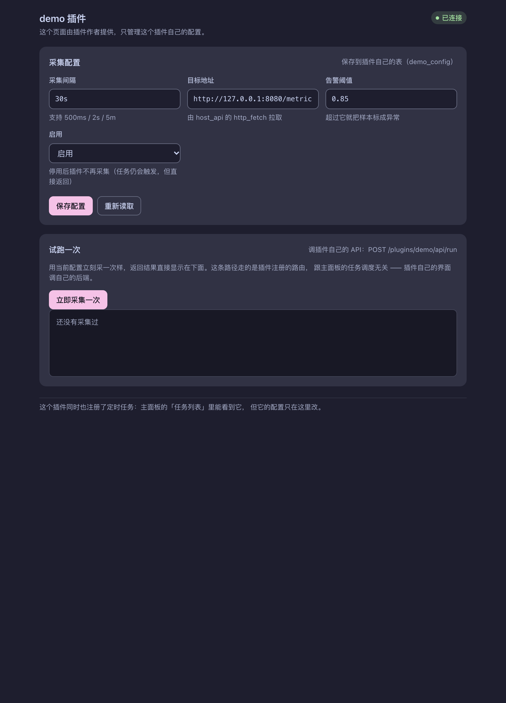

# plugin-panel —— Rust + QuickJS + PocketPy 动态插件任务面板

[](https://github.com/asunajs/panel/actions/workflows/ci.yml)

低配 ARM 盒子 / 旧手机上的常驻任务控制面板。最终目标：**常驻内存极低 / JS + Python 动态插件 /
毫秒级 Cron / SQLite 持久化 / 单二进制**。

| 实测（macOS arm64，release） | 值 |
|---|---|
| 常驻内存（纯宿主，`footprint` 独占） | **2.1 MB** |
| 常驻内存（+4 个 JS 插件 / 再 +2 个 Python 插件） | 2.9 MB / 7.2 MB |
| 空闲 CPU | 0.0–0.1%（调度器 deadline 驱动，空闲时一次都不唤醒） |
| 静态 musl 二进制（aarch64，含 QuickJS + PocketPy + SQLite + rustls） | 4.4 MB |

数字怎么读（macOS 的 `ps` 会把共享库页算进来）见 [内存与跨平台验证](docs/performance.md#81-内存优化实测)。

**CI 跑在真 ARM64 Linux 硬件上**（`ubuntu-24.04-arm`）：单元测试、冒烟测试（真的把服务跑起来）、
以及 `aarch64-unknown-linux-musl` 静态产物的构建与校验。开发机是 arm64 macOS，跑不了 Linux 二进制 ——
「目标平台上到底能不能跑」只能由 CI 回答，不能拿本机结果代替。
CI 在**打 tag / 手动触发 / 别人发 PR** 时跑；自己往 `main` 推 commit 不跑（一轮工作常常十几次提交，
大部分是文档与前端调整）。真正的验证时机是「要发一版」，而那就是 tag。

**界面**（`node scripts/screenshot.mjs` 生成，见 [§5 第 ㉒ 条](docs/testing.md#5-怎么验证)）：


主面板是 `web/` 下的多文件前端（零构建、原生 ES Module、hash 路由），编译期内嵌进二进制。
侧边栏底部两个徽标分别是引擎心跳和鉴权状态 —— 鉴权徽标会写出**凭据的存储形式**（明文 / Argon2id 哈希）。

插件可以自带配置页（由插件作者提供，位于 `/plugins/{name}/`，见 [§16.3](docs/changelog/13-webui.md#163-插件自有-ui一条路两个约束)）：



---

## 快速开始

```bash
# ① 从源码跑（首次会编译 SQLite bundled + QuickJS-ng + PocketPy）
cd rust-plugin-panel
PANEL_TOKEN=$(head -c 24 /dev/urandom | od -An -tx1 | tr -d ' \n') cargo run
open http://127.0.0.1:8787/          # 面板（登录时填上面那串令牌）

# ② 一键安装（旧手机 / ARM 盒子 / PC；自动检测架构 → 下载 → 校验 SHA256 → 装进 PATH）
curl -fsSL https://raw.githubusercontent.com/asunajs/panel/main/install.sh | bash
```

⚠️ **令牌是必填的**：没有「本机免登录」模式，没配令牌一律拒绝启动 —— 反代
（nginx / caddy / cloudflared）也跑在本机，转发过来的请求源地址全是 `127.0.0.1`，
「绑回环 = 安全」在挂反代的那一刻就不成立。见 [§13](docs/security.md#13-第十轮面板鉴权)。

想让它**不以明文落盘**，用 `plugin-panel hash-token` 生成盐 + 哈希，配 `PANEL_TOKEN_HASH`（见 [§18](docs/security.md#18-令牌不再明文落盘盐--哈希用户实测指出登录令牌不应该明文保存在本地)）：

```bash
printf '%s' "$TOKEN" | plugin-panel hash-token
# → $argon2id$v=19$m=19456,t=2,p=1$<盐>$<哈希>
```

开发时改前端不用重编（每次请求都读盘，改一行 CSS 刷新浏览器即可）：

```bash
PANEL_TOKEN=dev-token WEB_DEV_DIR=./web ./target/release/plugin-panel
```

环境变量总表（25 项，含执行预算、熔断阈值、worker 数、日志目录、插件数据根）见
[运行与配置](docs/configuration.md#3-运行)。

## 文档

| 文档 | 内容 |
|---|---|
| **[文档索引](docs/README.md)** | 全部文档的目录 + 「原 README §编号 → 文件」对照表 |
| [架构与目录结构](docs/architecture.md) | 进程/线程模型、三条链路、目录布局、影响后续扩展的设计决策 |
| [插件 API](docs/plugin-api.md) | 插件作者要看的全部：注册任务、日志、热更新、面板写操作、Cron 语法 |
| [host-api 规范 v1](docs/host-api.md) | 跨运行时公共契约：函数、payload、错误约定、四个宿主的能力矩阵 |
| [运行时选型与宿主 API 抽象](docs/runtimes.md) | 为什么选 PocketPy、两个解释器怎么共处一个线程、能力边界 |
| [运行与配置](docs/configuration.md) | 环境变量总表、开发时的前端热改、后台常驻 |
| [部署与分发](docs/deployment.md) | 一键安装、Release 产物、旧手机（Termux）、ARM 盒子（systemd） |
| [安全](docs/security.md) | 面板鉴权、令牌的存储形式（明文 / Argon2id）、防爆破 |
| [引擎自我保护](docs/engine-safety.md) | 执行预算、任务熔断、健康上报、优雅退出 |
| [内存与跨平台验证](docs/performance.md) | 实测内存、Axum 选型对比、CI、本地交叉编译 |
| [日志系统](docs/logging.md) | 插件级与面板级两条通道、规格、SSE、三份实现怎么不漂移 |
| [插件数据目录与文件系统](docs/plugin-fs.md) | 给插件一个自己的根：落点、围栏、与 Node 原生 `fs` 的差异 |
| [运行记录](docs/run-history.md) | 从「那次执行」点进日志：`runs` 表、保留期、界面、试跑记录 |
| [验证手册](docs/testing.md) | 从单元测试到端到端冒烟的全套验证入口 |
| [实测踩坑清单](docs/pitfalls.md) | rquickjs / rusqlite / 调度器 / 安装脚本 / PocketPy 嵌入，24 条 |
| [路线与遗留](docs/roadmap.md) | 还没做的账：慢任务隔离、连接池、ARM 真机、插件市场…… |
| [开发日志](docs/changelog/) | 按轮次的工程记录（第九轮起：为什么这么改、踩了什么、证据是什么） |

## 验证

```bash
cargo test                                  # 单元测试（cron / 调度 / jobs 语义 / WebSocket 客户端）
cargo clippy --all-targets -- -D warnings   # lint 门禁（41 条已清到 0；见下）
node scripts/test-web-assets.mjs            # 前端静态检查（ES Module、无内联 CSS/JS、无硬编码色值）
cargo build --release && python3 scripts/smoke.py ./target/release/plugin-panel   # 端到端冒烟
bash scripts/test-install.sh                # install.sh 的 15 项用例（shim 假造 Release）
```

冒烟测试不是「编译通过就算」—— 它真的把二进制拉起来，走一遍 HTTP / JSON / SQLite / 调度循环 /
插件路由 / 优雅退出，并在 Linux 上检查常驻内存（阈值 32 MB）。

**另外 18 条**（容错、执行预算、熔断、健康上报、热更新、跨重启存活、鉴权、防爆破、截图回归……）
连同每条的实测数据见 [验证手册](docs/testing.md)。

## 当前进度

| 轮次 | 内容 | 状态 |
|---|---|---|
| 第一轮 | Axum + 嵌入 QuickJS + 插件加载 + `host.log` + SQLite + 每秒 `on_tick` | ✅ 已验证 |
| 第二轮 | 毫秒级 Cron 调度 + `jobs` 表持久化 + 面板任务视图 | ✅ 已验证 |
| 第三轮 | 执行预算（死循环防护）+ 任务熔断 + 引擎健康上报 + SIGTERM 优雅退出 | ✅ 已验证 |
| 第四轮 | 内存优化（tokio worker 收敛）+ 跨平台 CI + 静态 musl 产物 | ✅ 本机 + **CI（真 ARM64 Linux 硬件）已验证** |
| 第五轮 | 部署与分发（install.sh 一键安装 + 打 tag 自动发 Release）+ SQLite 内存参数实测复核 | ✅ 脚本 15 项用例 + **真 Release 端到端验证** |
| 第六轮 | **双运行时：嵌入 PocketPy 跑 Python 插件 + 抽象宿主 API + JS 插件 HTTP 路由 + mtime 热更新** | ✅ 本机已验证（含静态 musl 产物 4.4 MB） |
| 第七轮 | Node.js / CPython 适配器（同一份插件跨 4 个运行时） | ✅ 适配器自带用例（Node 20 / CPython 51 项），见 [§10.5](docs/runtimes.md#105-跨运行时验证) |
| 第八轮 | **面板从只读变可操作**：手动触发 / 暂停 / 恢复 + 写接口防 CSRF | ✅ 已验证（冒烟 24 项） |
| 第九轮 | **`jobs` 表成为任务定义的权威来源**：`source` 区分插件声明 / 面板创建 + `register_handler` | ✅ 已验证（见 [§12](docs/changelog/09-jobs-authority.md#12-第九轮jobs-表成为任务定义的权威来源)） |
| 第十轮 | **面板鉴权**：令牌 + 内存会话 cookie + 常量时间比较 + 登录退避 + 审计日志 | ✅ 已验证（见 [§13](docs/security.md#13-第十轮面板鉴权)） |
| 第十一轮 | 插件目录变活（新增/删除/改名即时生效）+ 长跑内存实测 | ✅ 已验证（见 [§14](docs/changelog/11-live-plugin-dir.md#14-第十一轮插件目录变活--长跑内存实测)） |
| 第十二轮 | 任务定义可编辑（覆盖层）+ 失效任务清理 | ✅ 已验证（见 [§15](docs/changelog/12-editable-jobs.md#15-第十二轮任务定义可编辑--失效任务清理)） |
| 第十三轮 | **插件自有 WebUI**（主面板不是壳）+ 前端多文件零构建 + 测试运行 + `/classic` 退休 | ✅ 已验证（见 [§16](docs/changelog/13-webui.md#16-第十三轮插件自有-webui主面板不是壳)） |
| 第十四轮 | `/api/test/*` 限流 + 串行代价**先量化再改** → worker 池 | ✅ p99 318/820ms → 24ms，丢触发 12 → 0 |
| 第十五轮 | 卡片布局改两次才对 + 任务可编辑（面板对插件任务的**覆盖层**） | ✅ 已验证 |
| 第十六轮 | 任务删除的**墓碑**语义 + 插件管理（停用/启用、重载、源码） | ✅ 已验证 |
| 第十七轮 | 高危动作**二次确认** + 插件源码独立页面且**可编辑**（含改坏能回滚） | ✅ 已验证 |
| 第十八轮 | 令牌改为支持**盐 + 哈希**存储（Argon2id）+ `hash-token` 子命令 + 明文绝不落盘的断言 | ✅ 已验证（见 [§18](docs/security.md#18-令牌不再明文落盘盐--哈希用户实测指出登录令牌不应该明文保存在本地)） |
| 第十九轮 | **删掉「本机免登录」** —— 凭据变成必需品（类型上不存在「免鉴权」状态） | ✅ 已验证 |
| 第二十轮 | **防爆破**：反代下取真实客户端 IP + 跨来源的全局失败闸 + 状态可见 | ✅ 已验证（见 [§20](docs/security.md#20-防爆破第二十轮)） |
| 第二十一轮 | 宿主 API 加 **WebSocket 客户端**（`ws_open` / `ws_send` / `ws_recv` / `ws_close`） | ✅ 已验证（9 项对着**真的** WS 服务端收发） |
| 第二十二轮 | `legacy-tls`：只给 CBC 套件的上游（rustls 不实现 CBC）走平台 TLS | ✅ 真直播实测通过；默认构建一个字节都没变 |
| 第二十三轮 | 任务参数 / 随机表达式（抖动）/ 插件声明的侧边栏入口 / `smtp_send` / 按任务声明执行预算 | ✅ 已验证 |
| 第二十四轮 | **日志**：插件级与面板级两条通道、八档语义、SSE、三份实现共享向量 | ✅ 已验证（见 [§21](docs/logging.md#21-日志插件级与面板级两条通道第二十四轮)） |
| 第二十五轮 | **面板内的文件系统**：给插件一个自己的根 + 物理层围栏 | ✅ 已验证（见 [§22](docs/plugin-fs.md#22-面板内的文件系统给插件一个自己的根第二十五轮)） |
| 第二十六轮 | **运行记录**：从「那次执行」点进日志，试跑也进同一张表 | ✅ 已验证（见 [§24](docs/run-history.md#24-运行记录从那次执行点进日志第二十六轮) / [§26](docs/run-history.md#26-试跑也进运行记录第二十六轮续)） |
| 后续 | 插件市场 / 多实例 / 用户与权限 / ARM 真机 | 未开始（见 [路线与遗留](docs/roadmap.md)） |
