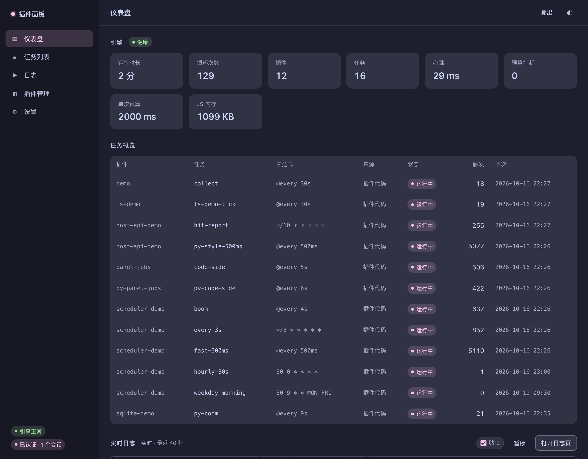

# 插件面板

插件面板是一个跑在自己设备上的定时任务工具。装好以后，用浏览器打开一个网页，就能添加任务、设置执行时间、查看运行结果。它不需要云服务，也不需要数据库服务器，一个程序加一个 SQLite 文件就能工作。

适合这些场景：

- 每天定时签到、领积分、备份文件、清理临时目录
- 在旧手机、树莓派或低配盒子上长期挂一个小服务
- 用 JavaScript 写插件，把一组重复操作做成按钮或定时任务
- 只想跑一段 Shell / Python / JavaScript，不想为它写完整插件

当前版本：**0.1.6**。设置页可以直接看到正在运行的面板版本。



---

## 先看一遍界面

打开面板后，左侧有几项：

- **仪表盘**：插件任务与脚本任务数量、最近运行、引擎状态
- **插件任务**：插件注册的定时任务，可以执行、暂停、修改时间
- **脚本任务**：放在任务目录里的脚本，以及由面板创建的脚本任务
- **日志**：按插件和级别查看运行输出
- **插件列表**：安装、启用、打开插件自己的页面（切换运行时的入口默认隐藏，可在设置里开启）
- **插件商城**：在插件列表右上角的入口，从 GitHub Release / 单文件安装（不占侧边栏）
- **设置**：主题、插件执行引擎开关、面板版本和编译信息

第一次使用，建议先按下面的步骤跑一个最简单的脚本任务。成功一次以后，再装插件或写复杂任务。

---

## 安装

### Linux、树莓派、旧手机（Termux）

在终端执行：

```bash
curl -fsSL https://raw.githubusercontent.com/asunajs/panel/main/install.sh | bash
```

脚本会识别 CPU 架构，从 GitHub Release 下载对应的静态二进制，校验 SHA256，然后放到 `PATH` 里。Termux 会装到 `$PREFIX/bin`，普通 Linux 一般装到 `~/.local/bin`。

如果 GitHub 下载慢，可以先把 `install.sh` 保存到本地再运行，或者用镜像：

```bash
PANEL_BASE_URL=https://你的镜像地址/plugin-panel bash install.sh
```

用 `gh-proxy.com` 加速时，脚本和产物都要走代理：

```bash
curl -fsSL -o /tmp/panel-install.sh \
  https://gh-proxy.com/https://raw.githubusercontent.com/asunajs/panel/main/install.sh

PANEL_BASE_URL=https://gh-proxy.com/https://github.com/asunajs/panel/releases/latest/download \
  bash /tmp/panel-install.sh
```

也可以一行跑完：

```bash
curl -fsSL https://gh-proxy.com/https://raw.githubusercontent.com/asunajs/panel/main/install.sh \
  | PANEL_BASE_URL=https://gh-proxy.com/https://github.com/asunajs/panel/releases/latest/download bash
```

固定版本就把 `latest/download` 换成 `download/v0.1.6`。代理只解决访问问题，安装脚本仍会校验 SHA256；但代理和校验和同源，正式环境建议优先用官方地址。

### 手动下载

到 [Releases](https://github.com/asunajs/panel/releases) 下载：

- 64 位 ARM（ARM 盒子、树莓派 3/4/5、手机）：`plugin-panel-aarch64-linux-musl`
- 32 位 ARM（armv7l、老树莓派、部分电视盒子）：`plugin-panel-armv7-linux-musleabihf`
- 普通电脑、VPS：`plugin-panel-x86_64-linux-musl`

下载后改个名字，加上执行权限：

```bash
chmod +x plugin-panel
./plugin-panel
```

### 从源码运行

需要 Rust 工具链。第一次编译会久一点。

```bash
git clone https://github.com/asunajs/panel.git
cd panel
cargo build --release
./target/release/plugin-panel
```

---

## 第一次启动

面板必须设置口令，没有口令会直接拒绝启动。

先生成一个口令哈希：

```bash
printf '%s' '换成你自己的口令' | plugin-panel hash-token
```

命令会输出一行 `export PANEL_TOKEN_HASH='prehash1:...'`，复制它，然后启动：

```bash
export PANEL_TOKEN_HASH='prehash1:...'
plugin-panel
```

看到类似下面的日志就说明启动成功：

```text
监听 http://127.0.0.1:8787
```

浏览器打开：

```text
http://127.0.0.1:8787
```

输入刚才的口令。登录成功后，会话会保存在浏览器里，短时间内不用重复输入。

> 本机临时调试也可以使用明文口令，但要显式打开开发开关：
>
> ```bash
> PANEL_TOKEN=dev-token PANEL_ALLOW_PLAIN_TOKEN=1 plugin-panel
> ```
>
> 这个开关只适合本机调试。放到服务器上时请用 `PANEL_TOKEN_HASH`。

### 让别的设备访问

默认只监听 `127.0.0.1`，也就是只有本机能打开。要让手机或另一台电脑访问，需要监听局域网地址：

```bash
BIND_ADDR=0.0.0.0:8787 plugin-panel
```

然后用 `http://这台机器的局域网IP:8787` 打开。

注意：一旦监听 `0.0.0.0`，同一网络里的人都能访问登录页。请使用强口令；如果要从公网访问，建议放在 Nginx、Caddy 或 Cloudflare Tunnel 后面，并开启 HTTPS。

---

## 第一个定时任务

先不写插件，用 Shell 脚本试一次。

### 1. 找到任务目录

面板默认从当前目录下的 `tasks/` 读取脚本。第一次启动后，这个目录会自动创建。结构可以是：

```text
tasks/
├── hello.sh
├── js/
│   └── report.mjs
├── py/
│   └── cleanup.py
└── sh/
    └── backup.sh
```

根目录、`js/`、`py/`、`sh/` 都会被扫描。脚本放在根目录也可以，放子目录只是为了整齐。

### 2. 写一个脚本

创建 `tasks/hello.sh`：

```sh
#!/bin/sh
# @name 打个招呼
# @cron */5 * * * *

echo "hello $(date)"
```

文件开头这两行是给面板看的：

- `@name`：任务在面板上显示的名字
- `@cron`：什么时候执行

保存后回到面板，打开「脚本任务」，应该能看到「打个招呼」，并且显示下一次执行时间。

### 3. 手动跑一次

在任务卡片上点「运行一次」。然后打开「日志」，应该能看到 `hello ...` 这一行。

如果看不到，先检查：

- 脚本有没有执行权限：`chmod +x tasks/hello.sh`
- `@cron` 是否写对
- 面板日志里有没有「脚本任务」相关报错

### 4. 改执行时间

可以直接改文件里的 `@cron`，也可以在面板任务卡片上点「编辑」，修改运行时间。面板上的修改会单独记住，文件本身不会被改。

常用写法：

| 表达式 | 含义 |
|---|---|
| `*/5 * * * *` | 每 5 分钟 |
| `0 * * * *` | 每小时整点 |
| `0 9 * * *` | 每天 9:00 |
| `30 8 * * 1-5` | 周一到周五 8:30 |
| `0 10,20 * * *` | 每天 10:00 和 20:00 |
| `0 10 1 * *` | 每月 1 日 10:00 |

面板同时支持 5 段和 6 段 cron。5 段是「分 时 日 月 周」，6 段在最前面多一个「秒」。

### 5. 用 Python 或 JavaScript

Python 脚本：

```python
# @name 清理临时文件
# @cron 0 3 * * *
# @timeout 120000

import os
import time

print("start", time.time())
```

需要机器上有 Python 3.8 以上。面板默认调用 `python3`，也可以用 `PANEL_PYTHON` 指定路径。

JavaScript 脚本需要 Node.js 20.6 以上，或者 Bun 1.0 以上：

```js
// @name 生成日报
// @cron 0 8 * * *
// @runtime node

console.log('report', new Date().toISOString())
```

`@runtime` 可以写 `node` 或 `bun`。JS 脚本还能 `import 'host-api'`，使用日志、SQLite、HTTP、WebSocket 等能力。

Python 和 Shell 脚本是普通进程，没有 `host-api`。这是有意的：它们本来就是操作系统的一部分。

---

## 安装插件

插件适合放更复杂的功能，比如带配置页的工具、需要保持状态的签到程序。插件用 JavaScript 写，默认跑在面板内置的 QuickJS 里，不占一个 Node 进程。

### 从插件商城安装

打开「插件列表」→ 右上角「插件商城」，找到条目后点「安装」。商城从 GitHub 解析版本、资产和 SHA-256，确认后直接写入 `plugins/`：

- 支持 Release 资产（`.zip` / `.js` / `.mjs` / `.ts`）和仓库里的单文件；
- 私有仓库配置 `PANEL_GITHUB_TOKEN` 或 `PANEL_GITHUB_TOKEN_FILE`（Contents: Read）即可；
- 单文件 `.ts` 在安装时用**内置 OXC** 转成 `.js`，运行时仍然只加载 `.js`；不需要 Bun 或 Node；
- 国内网络可选用 `PANEL_MARKET_PROXY=https://gh-proxy.com` 给**公开仓库**加速；私有仓库始终直连；
- 目录和格式见 [插件商城](docs/market.md)。

商城不提供评分、评论、自动更新或卸载；安装仍是覆盖写，确认弹层会提示同名文件会被覆盖。

### 上传插件

打开「插件列表」，点右上角「上传插件」：

- 单文件插件：选 `.js` 文件，会上传到 `plugins/js/`
- 多文件插件或带配置页的插件：打包成 `.zip` 上传
- 带配置页的目录插件，zip 里保留外层目录名，例如 `mcloud/index.html`、`mcloud/app.js`

上传后面板会自动扫描。插件卡片出现后，点「启用」或「加载」。如果没反应，点「全部重载」。

### 给插件配置

简单插件不用自己写配置页。插件列表每张卡上有一个「配置」按钮：

- 文本、数字、开关会显示成普通表单；
- 嵌套对象和数组切到「JSON」页改；
- 配置存在插件数据目录的 `config.json` 里，不在插件源码目录，覆盖安装不会丢。

插件代码只读一行：

```js
import { config } from 'host-api';

const cfg = config();
```

配置文件也可以直接编辑或用 `curl` 写：

```bash
curl -X PUT \
  -H 'X-Panel-Token: <令牌>' \
  -H 'x-panel: 1' \
  -H 'Content-Type: application/json' \
  --data @config.json \
  http://127.0.0.1:3030/api/plugins/插件名/config
```

保存后下一次任务生效，不需要重载插件。

### 插件从哪来

插件是别人写的程序，安装前先看一遍源码。Node/Bun 插件能读写文件、启动子进程、访问网络，面板不会把它们关进沙箱。

### 切换运行时

执行引擎设置默认隐藏（大多数插件用内置 QuickJS 就够了）。先在「设置 → 插件」里勾上「显示执行引擎设置」，插件卡片上才会出现运行时的下拉框和自定义解释器路径。

- **QuickJS**：默认，内存占用小，适合大多数插件
- **Node**：需要机器上有 Node.js 20.6+
- **Bun**：需要 Bun 1.0+

切换后插件会重新加载。某个插件用了 npm 包或原生 `fs`，通常就需要 Node/Bun。

---

## 定时、提前量和插件任务

普通脚本的 cron 就是它真正执行的时间。

有些插件需要在目标时间之前准备，比如抢兑、开抢前登录、提前拉取数据。这类任务会在插件任务页显示两个信息：

- **运行时间**：用户设置的目标时间，例如 `0 10,20 * * *`
- **提前唤醒**：提前多少秒唤醒，例如 `60s`

所以下一次执行可能显示 `19:59`，但目标仍然是 `20:00`。提前量由插件声明，也可以在插件自己的设置页里改。

插件任务卡片上的「编辑」修改的是运行时间；「暂停」会停止触发，但不会删除任务；「删除」对插件声明的任务是隐藏，插件更新后不会自动回来，需要点「恢复」。

---

## 常见问题

### 登录不上

先确认启动时用的是哪个口令。用 `PANEL_TOKEN_HASH` 启动时，浏览器里输入的是原始口令，不是那串 `prehash1:...`。

如果之前登录过，换口令后旧会话会失效，重新登录即可。

### 端口被占用

换一个端口：

```bash
BIND_ADDR=127.0.0.1:8790 plugin-panel
```

### 手机锁屏后任务不跑

Android 会清理后台进程。Termux 里执行：

```bash
termux-wake-lock
```

再到系统设置里关掉 Termux 的电池优化。不同手机的入口不一样，通常在「应用管理 → Termux → 电池 → 不受限制」。

### Python 插件在哪

没有 Python 插件了。`.py` 只作为脚本任务执行，不注册任务、不提供路由、不常驻。需要长期运行的 Python 程序，建议写成系统服务，或者用 Shell 脚本调用它。

### 任务不执行

按顺序检查：

1. 任务是不是被暂停了
2. cron 是不是写成了未来的时间
3. 脚本文件是否还在，路径是否正确
4. 「日志」里有没有报错
5. 插件任务的处理函数是否还存在

### 数据放在哪

默认都在启动目录下：

```text
data/panel.db      任务、账号、插件状态
plugins/           插件代码和插件页面
tasks/             脚本任务
logs/              插件日志
data/plugin-data/  插件自己的数据
```

备份时把这几个目录一起复制走即可。升级面板不会删除这些文件。

### 怎么升级

重新运行安装脚本，或者下载新版本替换二进制。数据目录不变，升级后任务和插件都还在。

升级前建议先备份 `data/panel.db`。

---

## 安全提醒

- 不要把没有口令的面板直接暴露到公网。
- 公网访问请走 HTTPS 反向代理。
- 插件和脚本都是可信代码，只安装来源明确的插件。
- 不要把 `PANEL_TOKEN`、`PANEL_TOKEN_HASH` 提交到 Git。
- 定期备份 `data/panel.db` 和 `plugins/`。

---

## 更多文档

- [文档索引](docs/README.md)：按「使用」「开发」「工程记录」分组
- [部署与分发](docs/deployment.md)：systemd、Termux、镜像、Release 产物
- [运行与配置](docs/configuration.md)：全部环境变量
- [脚本任务](docs/script-jobs.md)：文件头、退出码、两种来源
- [上传插件与脚本](docs/upload.md)：单文件和 zip 的路径规则
- [插件 API](docs/plugin-api.md)：写插件时看这份
- [host-api 规范](docs/host-api.md)：日志、SQLite、HTTP、WebSocket、SMTP、任务注册
- [运行时选型](docs/runtimes.md)：QuickJS、Node、Bun 怎么选
- [安全](docs/security.md)：鉴权、令牌存储、外部代码边界
- [开发日志](docs/changelog/)：每次改动的原因和踩过的坑

---

## 开发

```bash
cargo test
cargo clippy --all-targets -- -D warnings
node scripts/test-web-assets.mjs
cargo build --release
python3 scripts/smoke.py ./target/release/plugin-panel
```

前端在 `web/`，没有构建步骤，改完刷新浏览器即可。开发时可以用：

```bash
PANEL_TOKEN=dev-token PANEL_ALLOW_PLAIN_TOKEN=1 WEB_DEV_DIR=./web ./target/release/plugin-panel
```

---

## 许可证

这个仓库目前没有附带开源许可证文件。使用、分发或修改前请先联系仓库作者。
