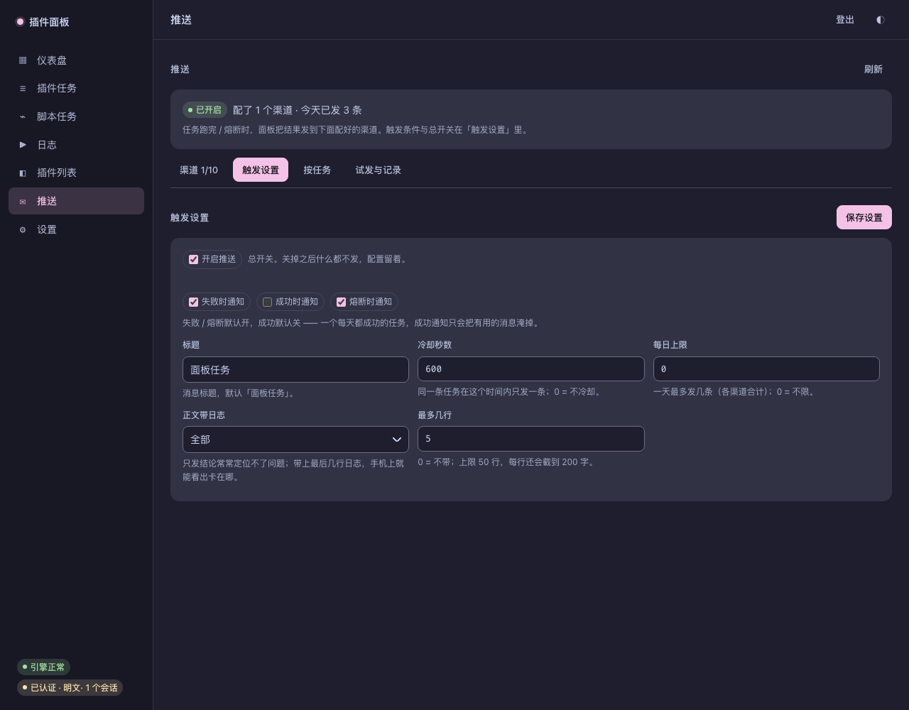
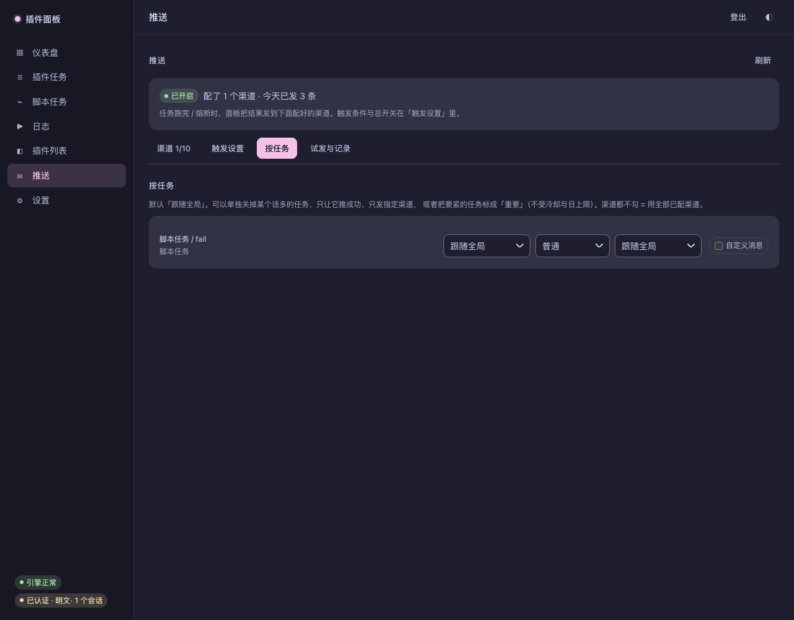

# 面板级推送

任务跑完或熔断时，面板把结果发到配置好的渠道（10 个，和插件侧同一套形状）。
插件自己的推送只看得见它自己的「一次运行结束」；面板级推送补的是**脚本任务、
面板创建的任务、以及熔断**这三类。

> 这一页是**面板自己**的推送，不是插件页里那一块。两者配置互相独立：
> 插件推送解决「插件想推什么」，面板推送解决「任务出事了要让人知道」。


页面分四个页签：**渠道**（配哪几个）、**触发设置**（什么时候发）、**按任务**（哪条任务例外）、**试发与记录**（刚才发出去没有）。页签只切显隐、不重画，所以在「渠道」里填了一半再切走，输入还在。

## 1. 触发条件

| 开关 | 默认 | 什么时候发 |
|---|---|---|
| 失败时通知 | 开 | 任何一次任务运行失败（定时 / 手动都算） |
| 成功时通知 | **关** | 运行成功。默认关：定时任务一天成功好几次，开了就是刷屏 |
| 熔断时通知 | 开 | 连续失败达到阈值、调度器停止这条任务时（与失败那条分开算） |

两道闸门（都只挡「重复的通知」，不挡第一条）：

- **冷却**：同一条任务 + 同一种结果（成功/失败分开）在 N 秒内只发一次，默认 600 秒。
  一条坏掉的任务每分钟失败一次，没有冷却就会被自己的推送淹没。
- **每日上限**：每天最多发 N 条，按渠道计（只算真正尝试发送的，跳过不算），
  默认 100，**0 = 不限**。试发（「发一条试试」）不计入上限。

### 等级：重要任务不受这两道闸门限制

两道闸门压的是「话多但不要紧」的任务，它们并不认识哪条要紧 —— 日上限一满，
最该收到的那条也会被一起吞掉。所以任务可以标成**重要**：

| 等级 | 冷却 / 日上限 |
|---|---|
| 普通（默认） | 照常生效 |
| 重要 | **跳过**，每次失败都发 |

「重要」只动这两道闸门，触发条件、渠道、正文都照旧。在「按任务」页签里设。

通知正文长这样：

```text
任务：mcloud / daily
结果：失败
触发：定时
时间：2026-10-19 23:30:00
耗时：1.2s
错误：登录过期
运行记录：r-20261019-233000-abc123
```

「运行记录」就是面板「运行记录」里那一条的 id，可以据此点进那次执行的日志。

### 正文里带日志

只发结论（「脚本退出码 1」）常常定位不了问题。可以让正文带上这次运行的最后几行日志：

| 设置 | 默认 | 说明 |
|---|---|---|
| 正文带日志 | 不带 | 不带 / 仅错误 / 警告以上 / 全部 / 全部（含调试） |
| 最多几行 | 10 | 0 = 不带；上限 50 行，每行截到 200 字，整段上限 800 字 |

日志按 `run` 标签取**这次执行**的，所以正文里就是日志页「这次执行」那一屏：
先读内存环，没有再回退到日志文件（文件是异步写的）。熔断通知没有 run 标签，不带日志。

```text
任务：脚本任务 / fail
……
运行记录：20261021-003338-0000

日志（全部，最近 4 行）：
  00:33:38 [info] 第一步：登录
  00:33:38 [error] 第二步：重试中
  00:33:38 [error] 第三步：还是不行
```



### 按任务覆盖

默认所有任务都用上面的全局条件。某条任务要例外时，在「按任务」页签单独设：

| 模式 | 含义 |
|---|---|
| 跟随全局（默认） | 用上面的失败 / 成功开关 |
| 不推 | 这条任务什么都不发（连熔断也不发） |
| 只推失败 | 失败推、成功不推（含熔断） |
| 只推成功 | 成功推；失败不推，熔断仍推 —— 它停了你得知道 |
| 成功和失败都推 | 不看全局那两档 |

另外两项也是按任务设：

| 项 | 取值 |
|---|---|
| 等级 | 普通（默认）/ 重要（不受冷却与日上限） |
| 正文日志 | 跟随全局（默认）/ 不带 / 仅错误 / 警告以上 / 全部 |

还能只让它发**指定渠道**（勾选；都不勾 = 用全部已配渠道）。规则只存偏离默认的任务，
「跟随全局」= 删掉那一行 —— 以后改全局，它立刻跟着变。



## 2. 渠道

顺序与界面一致，与插件侧 push.ts 逐字对齐：

| id | 名称 | 必填 |
|---|---|---|
| pushplus | pushplus | token |
| serverChan | Server酱 | SendKey |
| workWeixin | 企业微信推送 | corpid / corpsecret / agentid（两步：先换 access_token） |
| workWeixinBot | 企业微信Bot推送 | webhook 地址 |
| tgBot | Telegram Bot 推送 | bot token / chat_id（群 ID 是负数） |
| bark | Bark ios 推送 | key（level 可选，默认 passive） |
| twoIm | 回逍推送 | key / sid |
| dingTalk | 钉钉推送 | access_token（加签密钥可选） |
| email | 邮件消息 | SMTP 主机 / 发件人 / 密码 / 收件人（端口、tls 可选） |
| customPost | 自定义消息 | 请求地址（方法、请求头、请求体可选） |

几处**看着像笔误、实际是原文**的地方（与插件侧一致，不要「顺手改好」）：

- pushplus 的地址是 **http://**，不是 https；
- Server酱的 desp 里每个换行**翻倍**；
- 钉钉正文前面有**一个前导空格**；
- Telegram 的 chat_id 是 **snake_case**；
- 自定义消息：URL 里的 {title} / {text} 各只替换一次并按 encodeURIComponent 转义；
  请求体里的替换**不转义**，替换完必须仍是合法 JSON（标题里带引号会明确报错）。

邮件只发**一段纯文本**，不做附件、不做 8BITMIME 协商 —— 理由见
[smtp.rs 的文件头](../src/smtp.rs)。明文连接上默认不发凭据（与 smtp_send 同一条策略）。

## 3. 配置存在哪、秘密怎么处理

- 配置存在 **panel.db 的 push_config 单行表**里（不是 settings.json）：它含 token /
  密码、形状是嵌套的，和「运行参数」不是同一类东西。DB 文件本身是 0600。
- 读接口**只回掩码**：secret 字段显示成 abc…xyz（共 N 字符），界面永远拿不到原文。
- 保存是**增量**的：set 里只放这次填的字段，留空 = 不改；remove 是显式删除渠道。
  界面拿不到旧值（只有掩码），所以不能整份覆盖 —— 纯合并又删不掉渠道，两者都要。

## 4. 接口

| 方法 | 路径 | 说明 |
|---|---|---|
| GET | /api/push | 渠道元数据、掩码后的字段、已配列表、最近投递、今天已发条数 |
| POST | /api/push/config | 增量保存（enabled / title / settings / set / remove） |
| POST | /api/push/test | 立刻发一条，逐渠道返回 sent / skipped / failed |

写接口都要带 x-panel: 1（防 CSRF），并走正常会话鉴权。

## 5. 排障

- 界面「推送」页底部有**最近 20 条投递**：时间、任务、渠道、结果、原因。
  它回答的是「到底发没发、哪个渠道失败了」，不是审计日志（只留 200 条）。
- 面板日志里搜索 scope push：每次通知的汇总、每个失败渠道的原因都在那里。
- 「发一条试试」把「配置错了」和「任务没跑到发送那一步」分开 ——
  这是推送最难受的失败方式（配了、收不到、却不知道卡在哪）。
- 有些失败藏在 **HTTP 200** 里：pushplus 的 `code 905`（账户未实名）、企业微信 / 钉钉的
  `errcode`、Server酱的 `code`。面板按渠道把它们判成失败并显示原文，不会报「已发送」。

## 6. 安全边界

- **SSRF**：面板自己发起的出站请求走与插件 http_fetch 同一张判定表 ——
  拒绝回环、链路本地（云元数据）、组播、非规范 IPv4 数字写法；**放行局域网**
  （家用 NAS / 内网服务是常态）。URL 里带用户名/密码直接拒绝。
- **不跟随重定向**：重定向是 SSRF 最常用的一跳（公网地址 302 到 127.0.0.1）。
  推送渠道没有一个需要 3xx，真遇到就如实报错。
- **开关分开**：插件的 HOST_API_ALLOW_PRIVATE 不会顺手放开面板推送；
  要让推送访问回环/内网，显式设 PANEL_PUSH_ALLOW_PRIVATE=1（启动时打一条 warn）。
- 推送失败不会影响任务本身：发送在独立线程里，队列满就丢弃并打日志。

## 7. 已知边界

| 边界 | 说明 |
|---|---|
| 按任务是例外，不是矩阵 | 只有「模式 + 渠道子集」两维；冷却 / 标题 / 日上限仍是全局 |
| 冷却在内存 | 面板重启后冷却清零。这是有意的：重启通常意味着刚改过配置，压着不发更让人困惑 |
| 队列有界 | 256 条；满了两条路都不通时丢事件并打 warn，绝不阻塞调度 |
| 邮件只发文字 | 不做附件、不做 HTML 模板；要发文件请用别的通道 |
| 自定义消息单次替换 | 与插件侧一致，不是模板引擎；复杂编排请用插件 |

## 8. 验证

- 单元测试：push::channels（请求形状、编码、钉钉签名向量、掩码、增量合并）、
  push::tests（正文格式、配置往返、非法配置拒绝）、db::tests::push_*（单行 upsert、
  投递计数与裁剪）。
- 全量：cargo test（451 项）。
- 前端：node scripts/test-web-assets.mjs（270 项）。
- 手工：设置页 → 推送 → 配一个渠道 → 「发一条试试」；再让一条任务失败一次，
  看「最近投递」里有没有它。
